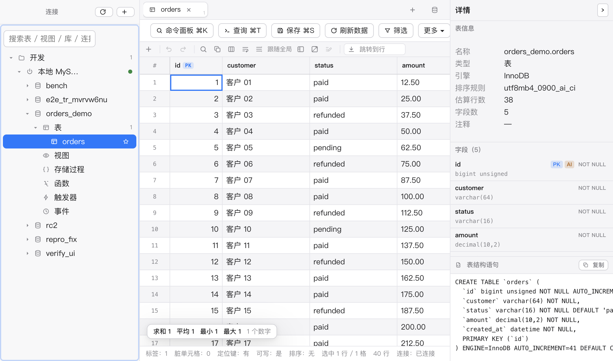
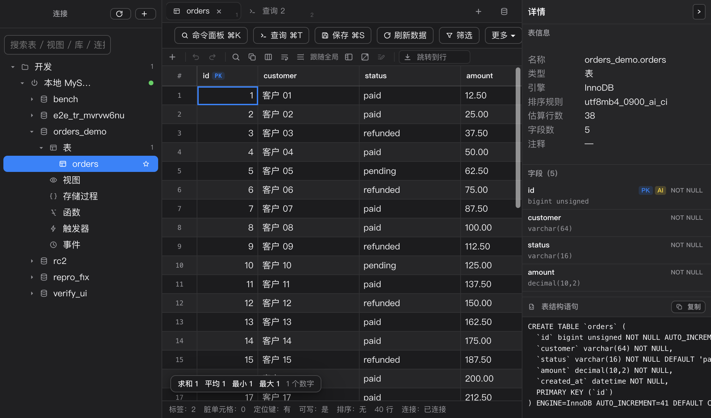

<div align="center">

# DB Studio

**反应最快的 macOS 数据库查看器**

面向「间歇性查看/修改数据」的开发者，不是 DBA 的全功能工作台。
MySQL 优先、单机自用、macOS 原生观感 —— 对标 Navicat Premium，但差异点不是「免费平替」，是**快**。

Electron 44 · React 19 · TypeScript strict · CodeMirror 6 · 列式 IPC · 虚拟滚动

[](docs/RELEASES.md)
[](#验证)
[](#系统与环境限制)
[](#适配芯片)
[](LICENSE)

</div>

---

<details open>
<summary><b>界面预览（浅色 / 深色，真机截图）</b></summary>

| 浅色 | 深色 |
|---|---|
|  |  |

更多截图（连接编辑器、库表树、右键菜单、SQL 编辑器、网格交互）见 [`docs/design-mockups/`](docs/design-mockups/)。

</details>

---

## 目录

- [它解决什么问题](#它解决什么问题)
- [性能实测](#性能实测)
- [核心特性](#核心特性)
- [整体架构](#整体架构)
- [快速开始](#快速开始)
- [打包与构建](#打包与构建)
- [适配芯片](#适配芯片)
- [支持的客户端](#支持的客户端)
- [系统与环境限制](#系统与环境限制)
- [验证](#验证)
- [文档地图](#文档地图)
- [设计红线](#设计红线)
- [License](#license)

---

## 它解决什么问题

开发者经常需要「连上库 → 找到那张表 → 看几眼数据 → 改两三个字段」，这个动作一天可能重复很多次，但**每次都要等**。Navicat 功能全但重、启动慢；命令行快但改数据要手写 SQL、没有安全网。

DB Studio 只押一件事：**把「连接 → 定位表 → 查改数据」这条核心链路做到最快、最跟手**，其余功能克制。

北极星指标是「单日完成核心闭环的次数」。性能不是口号，是**写进代码的验收门槛**（见下）。

## 性能实测

Spike 阶段用 **1000 万行 fixture**（MySQL 8.0，Docker）在 M5 Pro / 120Hz 上的实测，全部远优于预算：

| 指标 | 实测 P50 | 预算 |
|---|---|---|
| 冷启动 | **217 ms** | ≤ 1500 ms |
| 表首屏（连接→看到数据） | **8.4 ms** | ≤ 1000 ms |
| 首行渲染 | **12.9 ms** | — |
| 带索引排序 | **6.9 ms** | ≤ 1500 ms |
| 网格滚动帧率 | **120.5 FPS** | ≥ 55 FPS |
| 100 万行 xlsx 导出 | **6.26 s** | ≤ 30 s |
| 常驻内存 | 远低于预算 | ≤ 250 MB |

关键机制：**列式 ArrayBuffer IPC**（主进程拉数据 → 列式编码 → 渲染层**只解码可视区**，恒定 0.029ms，与结果集大小无关；对照 JSON 全量解析 50 万行需 338ms）+ **虚拟滚动**（只渲染可视区 + 缓冲，滚动热路径零对象分配）。

> 详细数据与论证见 [`docs/engineering/SPIKE-REPORT-v1.0.md`](docs/engineering/SPIKE-REPORT-v1.0.md)。

## 核心特性

<details>
<summary><b>数据网格（主战场）</b></summary>

- 虚拟滚动，千万行级流畅；行号列 sticky、冻结列、分组行条纹、结果集转置
- 就地编辑单元格，**只提交被改动的单元格**（绝不整行覆盖），保存前逐条 SQL 原文预演
- 无主键/唯一键的表**自动只读**（写操作安全红线）
- 三态排序（服务端执行）+ Shift 多列；15 种操作符的参数化筛选构建器 + 已保存筛选方案
- 单元格 SQL 表达式模式（填 `NOW()`/`UUID()` 原样嵌入）、批量编辑条（多行同列 Apply/Discard）
- **撤销 / 重做**（⌘Z / ⇧⌘Z）：单元格、批量、新增行、复制行进同一撤销栈（上限 100 步），保存成功或放弃改动时整栈清空
- **ENUM 专用下拉**（选项只来自 DDL 定义值）+ **日期时间辅助控件**（原始字符串逐字可见，日期控件只改日期段，时间与 6 位微秒原样保留）
- **六态网格**：loading / error / disconnected / idle / empty / ready，各有独立块与重试入口；状态栏行数带口径（`exact` / `estimated` / `truncated`）
- **表视图记忆**：每张表记住排序与筛选，重开即恢复（只记「怎么看」，不记数据）
- 外键值导航与下拉、鼠标拖选矩形选区、⌥↑ 递进选区、⌘F 结果集内查找、⌘F12 列快速定位
- 复制 6 格式（TSV/CSV/JSON/Markdown/INSERT/UPDATE 带真实值）；**默认只复制值、不带列名表头**（需要列名走复制菜单的「含列名」，Markdown 永远带表头）
- 选中区聚合统计；单元格完整值弹窗（JSON 高亮 / BLOB 预览与存盘）

</details>

<details>
<summary><b>SQL 编辑器（CodeMirror 6）</b></summary>

- **首屏 0 字节**：编辑器作为 lazy chunk 加载，不拖慢启动
- 多语句多结果 Tab、执行全部/选中、KILL QUERY 真取消、EXPLAIN 树/表格双视图
- 实时错误检测下划线（纯前端静态推断，不打库）、内联显示每条语句耗时
- 基于 schema 缓存的补全（表名/库名/字段属性）、SQL 专属双主题高亮、自研轻量格式化
- 草稿自动保存恢复、片段收藏、查询历史（星标/删单条/按连接过滤）
- **SQL 文件三件套**（打开 / 另存为 / 保存）+ 结果标签固定/重命名
- **结果集预算**：超过 `200k 行 / 64MiB` 显式截断并告知（不做静默截断）
- 「打开源表」可带**定位键**跳到对应行；按钮文案明确**不继承** WHERE/ORDER BY/LIMIT
- **查询结果写回**：单表 SELECT + 主键 → 可编辑表格（JOIN 结果保持只读，fail-closed）

</details>

<details>
<summary><b>连接与安全</b></summary>

- 连接 CRUD + 8 色标签 + 嵌套分组；SSH 隧道（密码/私钥）+ SSL/TLS
- 密码经 macOS **safeStorage** 加密落盘（绝不明文，保存前扫描自检）
- 连接级只读模式：写语句被 **SQL AST 白名单**拦截（node-sql-parser，解析失败 fail-closed）
- 断线检测 + 自动重连横幅；三级危险操作确认（二次确认/输对象名/生产红标自动升级）

</details>

<details>
<summary><b>对象浏览 · 导入导出 · 应用壳</b></summary>

- 5 层库表树（6 类对象：表/视图/存储过程/函数/触发器/事件）、字段名反查搜索、树展开记忆
- 详情面板三区块：表信息 / 字段（**注释常驻显示**）/ 建表语句 DDL；单元格完整值在弹窗里看
- 可视化表设计器（字段/索引/外键三 Tab + 差异 ALTER + DDL 预览）
- 导入 4 格式（csv/tsv/xlsx/json）向导；导出 5 格式（xlsx/csv/json/sql/markdown）+ 整库备份
- **导出四范围**（选区 / 已加载 / 全部匹配 / 整库），每项标注是「快照」还是「重查」
- 全部导入导出跑在 **utilityProcess**（可 kill = 真取消，崩溃不拖垮主进程）
- **工具栏身份条**：连接 / 环境 / 库 / 对象四段常显，缺数据时如实写「未命名连接」而非拿 connId 顶替；按**可用宽度**在 full/compact 间切换（导出/导入/设计/粘贴收进「更多」菜单，保存与筛选永不折叠）
- **更新检查四态**：`unconfigured` / `failed` / `update` / `latest` —— 没配发布通道不会谎报「已是最新」
- macOS 原生菜单栏、原生交通灯、Liquid Glass 玻璃窗、三栏可拖拽布局、多标签、多窗口、会话恢复、三态主题、⌘K 命令面板

</details>

## 整体架构

**npm workspaces monorepo**，三层清晰分离：纯逻辑层（可离线单测）→ Electron 主进程 → React 渲染层。

```
┌──────────────────────────────────────────────────────────────┐
│  渲染层 (React 19)  apps/desktop/renderer/src                  │
│  ─ 三栏 UI：库表树 · 多标签工作区 · 详情面板                      │
│  ─ 虚拟滚动网格（行 DOM 池化 + 绝对定位）                         │
│  ─ CodeMirror 编辑器（lazy chunk，首屏 0 字节）                   │
│  ─ backend.ts：有 IPC 走真实现，纯浏览器 dev 自动降级 demo 后端    │
│  ─ 只解码可视区，从不 decodeAll/materialize                       │
└───────────────▲──────────────────────────────────────────────┘
                │  列式 ArrayBuffer IPC（transfer，只解可视区）
                │  通道清单单一来源：shared/ipc-channels.ts
┌───────────────┴──────────────────────────────────────────────┐
│  主进程 (Electron 44)  apps/desktop/src/main                   │
│  ─ window（Liquid Glass）· menu · window-manager（多窗口）       │
│  ─ ipc-handlers · session-registry · connection-store          │
│  ─ tunnel-manager（SSH）· transfer-manager · object-meta        │
│  ─ workers/：export / import / sql-script（utilityProcess）      │
│  ─ preload.cjs（sandbox 开启，必须 CJS）                         │
└───────────────▲──────────────────────────────────────────────┘
                │  依赖注入（core 包不认识 Electron）
┌───────────────┴──────────────────────────────────────────────┐
│  纯逻辑层 (packages/core-*)  无 Electron/React，纯函数可离线单测  │
│                                                                │
│   连接与驱动           数据与网格            安全与 SQL           │
│   core-connection      core-grid-view       core-sql-guard ★    │
│   core-driver-mysql    core-ipc-codec       core-sql-ident ★    │
│   core-ssh-tunnel      core-mutation ★      core-sql-editor     │
│   core-secret          core-filter          core-table-designer │
│   core-schema-cache    core-clipboard                           │
│                        core-import/export                      │
│   交互辅助：core-tree-view · core-command-palette · core-history │
└──────────────────────────────────────────────────────────────┘
        ★ = 承载「红线」的关键包（见下方设计红线）
```

### 数据流

```
MySQL ──mysql2──▶ 主进程拉取 ──列式编码──▶ ArrayBuffer(transfer)
                                              │
                                              ▼
                        渲染层只解码可视区 ──▶ 虚拟滚动网格（行 DOM 池化，key=全局行号）
```

- **写操作**：网格脏单元格 → `core-mutation` 构造 INSERT/UPDATE/DELETE → `core-sql-guard` AST 校验 → **逐条 SQL 原文预演** → 用户确认 → 事务提交。**只提交被编辑的单元格**。
- **只读拦截**：两层，**只有第二层算数** —— UI 置灰只是体验，真正的安全层是主进程 `core-sql-guard` 的 AST 白名单（快捷键/粘贴/编辑器都能绕过 UI）。
- **取消**：真取消 —— 查询走 `KILL QUERY`，导入导出走 `kill utilityProcess`。

### 模块职责

| 包 | 职责 |
|---|---|
| `core-connection` | 连接配置模型 / 校验 / 生命周期状态机 |
| `core-driver-mysql` | mysql2 封装：流式 / KILL QUERY 取消 / 元数据 introspect（R10 参数规范直接决定数据正确性） |
| `core-ipc-codec` | 列式 ArrayBuffer 编解码（只解可视区，内存有界） |
| `core-grid-view` | 网格视图模型：虚拟滚动可视区 / 选择模型 / 键盘导航 / 排序三态 |
| `core-mutation` ★ | 脏单元格 → SQL（头号红线的落地处；`isEditable()` 是可编辑判定的唯一权威） |
| `core-sql-guard` ★ | SQL 只读守卫 / 危险分级（AST 白名单，node-sql-parser，fail-closed） |
| `core-sql-ident` ★ | MySQL 标识符转义（防注入最后一道；零依赖，渲染层可安全引入） |
| `core-sql-editor` | 编辑器纯逻辑：语句拆分（字符串/注释感知）、补全、格式化、lint、EXPLAIN 判定 |
| `core-schema-cache` | schema 磁盘快照 + 行定位策略（主键/唯一键/none） |
| `core-secret` | safeStorage 凭据加密（替换已停止维护的 keytar） |
| `core-ssh-tunnel` | SSH direct-tcpip 转发（ssh2 可注入，单测不起真服务） |
| `core-filter` / `core-clipboard` | 筛选构建器 / 剪贴板序列化 |
| `core-import` / `core-export` | 导入导出（跑在 utilityProcess） |
| `core-tree-view` / `core-command-palette` / `core-history` | 树视图模型 / 命令面板 / 历史库（node:sqlite） |
| `core-table-designer` | 表设计器差异 DDL |

> 每个包的详细契约见 [`packages/README.md`](packages/README.md)；主进程安全基线见 [`apps/desktop/README.md`](apps/desktop/README.md)。

## 快速开始

### 直接装（不想编译的话）

从 [Releases](https://github.com/canyuexiyang/db-studio/releases/latest) 下 `DB-Studio-<版本>-arm64.dmg`（Apple Silicon，macOS 26+）。仅 ad-hoc 签名、未做公证，首次打开请右键 →「打开」，或：

```bash
xattr -dr com.apple.quarantine "/Applications/DB Studio.app"
```

### 环境要求

| 项 | 要求 |
|---|---|
| macOS | **26.0+**（Liquid Glass 需要；低版本自动降级为 CSS 毛玻璃，见[环境限制](#系统与环境限制)） |
| Node.js | **≥ 22.13**（开发实测 v22.22.2 / npm 10.9.7） |
| 数据库 | MySQL 8.0+（跑 e2e/性能测试需要本地 fixture） |

### 安装与运行

```bash
# 1. 安装依赖（npm workspaces）
npm install

# 2. 开发模式：起真实 Electron 应用（build + electron）
npm run start

# 3. 纯浏览器 dev（无需 Electron / 数据库，自动用 demo 后端调 UI）
npm run e2e:ui          # 起 vite dev server + 跑 UI 回归
#   或手动：cd apps/desktop/renderer && npm run dev
```

> **纯浏览器模式**：渲染层 `backend.ts` 检测不到 `window.dbStudio` 时自动降级为 demo 后端（内存假数据），无需数据库即可调 UI。这是 UI 开发/回归的默认方式。

### 本地 MySQL fixture（跑真库测试需要）

```bash
# 用 Docker 起一个含 1000 万行的 MySQL（端口 13306）
docker run -d --name dbstudio-mysql -p 13306:3306 \
  -e MYSQL_ROOT_PASSWORD=<your-password> -e MYSQL_DATABASE=demo mysql:8.0
# 种子脚本见 spike/s5-fixture-ipc/seed/seed.mjs
```

## 打包与构建

### 构建（不打包）

```bash
npm run build           # 渲染层 + 主进程 + preload + 复制 workers
npm run build:renderer  # 仅渲染层（vite build）
npm run build:main      # 仅主进程
npm run build:preload   # 仅 preload
npm run clean           # 清理 dist（独立命令，构建链本身零删除）
```

### 打包成 macOS 应用

```bash
npm run dist            # 构建 + electron-builder → .app + .dmg（arm64，ad-hoc 签名）
npm run dist:dir        # 构建 + 只打 .app 目录 + ad-hoc 重签 + 自检（本机验证用）
```

产物输出到 `apps/desktop/release/`（已被 `.gitignore` 排除）。

### 版本号

**唯一来源是根 `package.json` 的 `version`**（electron-builder 写入 `Info.plist`，子包版本不参与）。改版本号只改这一处。发布记录见 [`docs/RELEASES.md`](docs/RELEASES.md)。

### 安装到本机

```bash
npm run dist:dir
# 🔴 覆盖安装前先把旧包挪走留回滚（下面这步别省）
mv "/Applications/DB Studio.app" "apps/desktop/release/.prev-installed-<旧版本>.app"
ditto "apps/desktop/release/mac-arm64/DB Studio.app" "/Applications/DB Studio.app"
xattr -dr com.apple.quarantine "/Applications/DB Studio.app"   # 去掉隔离属性（ad-hoc 签名）
node scripts/verify-installed.mjs                              # 22 项安装后真机验收（含版本一致性断言）
```

> ⚠️ 装完新包**第一次**跑 `verify-installed` 可能撞上 CDP 的冷启动窗口（端点已打印、`/json/version` 已 200，但 ws 握手还没就绪）。
> 脚本已加固（探活 + 重试 3 次）；若仍失败，重跑一次即可 —— **别误判成新包有缺陷**。

### 打包关键点（`electron-builder.yml`）

- **签名**：`identity: null` = 仅 **ad-hoc 签名**，自用单机不做 Developer ID / 公证。EB 会跳过签名并残留 Electron 模板旧签名，因此 `pack-dir.mjs` 打包后补一次**外层** ad-hoc 重签（`codesign --force --sign -`）。🔴 **绝不用 `--deep`**（会抹掉内嵌 Helper 的 entitlements，导致网络服务崩溃、渲染层加载不出）。
- **原生模块**：`electron-window-glass` 自带 arm64/x64 预编译 N-API 产物，**无需 rebuild**（`npmRebuild: false`）；`.node` 不能从 asar 加载 → `asarUnpack: **/*.node`。
- **workspaces 运行时依赖**：EB 只自动收集根 `dependencies` 闭包，对 workspace 提升有缺陷 → `mysql2` / `electron-window-glass` / `node-sql-parser` / `@dbstudio/core-import` 等用 `extraResources` 显式复制到 `Contents/Resources/node_modules/`（asar 外）。**新增运行时依赖要同步维护 `electron-builder.yml` 的 `extraResources`。**
- **更新通道**：`electron-builder.yml` 的 `publish:`（GitHub provider）**只在打 dmg 时才生成 `app-update.yml`**，`--dir` 产物不会有 → `pack-dir.mjs` 在 **ad-hoc 重签之前**补写 `Contents/Resources/app-update.yml`（重签后写会破坏签名）。`electron-updater` 及其 16 个运行时依赖闭包同样要走 `extraResources`。
- **发布**：有 `publish:` 段后打包必须显式 `--publish never`（EB 默认 `onTagOrDraft` 会尝试上传）。Release 资产**必须同时上传 `latest-mac.yml`**，否则应用内检查更新只能如实报 `failed`。

> 完整打包陷阱（宿主 brokered-fs shim、safe-delete 护栏、NODE_OPTIONS 清理等）见项目长期记忆与 `docs/devlog/`。

## 适配芯片

| 架构 | 支持 | 说明 |
|---|---|---|
| **Apple Silicon（arm64）** | ✅ 主要目标 | 默认打包架构（`electron-builder.yml` target = arm64）；开发与全部性能实测在 **Apple M5 Pro（15 核 / 48GB）** 上完成 |
| **Intel（x64）** | ✅ 运行时兼容 | `electron-window-glass` 自带 `darwin-x64.node` 预编译产物；但**默认不产出 x64 安装包**，需要时改 `electron-builder.yml` 的 `mac.target.arch` 加 `x64`（或 `universal`）后重新 `npm run dist` |

- 架构判断与玻璃降级在 `apps/desktop/src/main/window.ts`；原生模块按 `process.arch` 自动选 `.node`。
- 未做 x64 专项性能实测 —— x64 上帧率/冷启动数字可能不同，但功能路径一致。

## 支持的客户端

DB Studio 是**桌面客户端应用**，本身不是服务端。这里的「客户端」指 DB Studio 能作为客户端连接的目标数据库：

| 数据库 | 状态 | 驱动 |
|---|---|---|
| **MySQL 8.0+** | ✅ 完整支持（当前唯一） | `mysql2` |
| PostgreSQL | ⬜ 类型位已预留，UI 置灰「即将支持」 | `pg`（未接入） |
| Redis | ⬜ 同上 | `ioredis`（未接入） |
| MongoDB | ⬜ 同上 | `mongodb`（未接入） |

连接形态：
- **直连**：主机 / 端口 / 用户 / 密码 / 默认库
- **SSH 隧道**：跳板机（密码或私钥认证），SSH channel 直接作 mysql2 底层流，不起本地端口
- **SSL/TLS**：CA / 客户端证书 / 密钥，可关闭证书校验

> 实施顺序是「MySQL 打样 → PG → Redis → Mongo，串行做透」。多库支持是最大市场差距，但在 MySQL 链路修圆满前不启动（见 [`docs/research/竞品调研与功能路线图.md`](docs/research/竞品调研与功能路线图.md) §2.3）。

**运行 DB Studio 的宿主客户端**：仅 **macOS 桌面**（不做 Windows / Linux / Web / 移动端，见[环境限制](#系统与环境限制)）。

## 系统与环境限制

### 硬性限制

| 限制 | 说明 |
|---|---|
| **仅 macOS** | 明确不做 Windows / Linux / Web / 移动端（PRD §三 非目标）。窗口用了 `transparent: true` + macOS 原生玻璃，跨平台无意义 |
| **macOS 26.0+ 才有原生玻璃** | 系统版本判断用 `os.release()`（Darwin 内核主版本 ≥ 26）。低于此版本 `applyGlass()` **自动降级为 CSS 毛玻璃**（`mode: 'css'`），功能不受影响，只是少了原生 Liquid Glass 质感 |
| **仅简体中文** | UI 文案只做简体中文，不做多语言（PRD §三 非目标） |
| **单机自用** | 不做登录 / 团队协作 / 云同步 / 账号体系 / License（PRD §三 非目标） |

### 玻璃窗口的四条降级路径（`applyGlass()` 永不抛异常）

| 情况 | mode | 结果 |
|---|---|---|
| 非 macOS | `none` | 平台不支持，普通窗口 |
| Darwin < 26 | `css` | 系统版本不足，CSS 毛玻璃降级 |
| 用户在设置中关闭 | `css` | 尊重用户选择 |
| 原生模块加载失败 | `css` | 异常兜底（截断到 120 字符） |
| 网格滚动 FPS < 50 | `css` | FPS 保护，自动关原生玻璃 |

### 开发/构建环境注意

- **两套 tsconfig 互不包含**：根（packages + 主进程，pure Node lib）+ renderer（DOM + JSX），`npm run typecheck` 串联两者，**改动后必须全绿**。
- **`@dbstudio/*` 别名三处同步**：根 tsconfig `paths` / `vitest.config.ts` alias / renderer tsconfig，漏一处会「typecheck 过但测试 fallback 到 node_modules」。
- **preload 必须是 `.cjs`**：sandbox 开启时 ESM preload 会失败。
- **渲染层产物必须 `base: './'`**：`file://` 下绝对路径会解析到磁盘根 → 全白屏（而主进程 IPC 全通，调接口测不出来）。
- **e2e 复用本机 Chromium**：`~/Library/Caches/ms-playwright/`，缺失时设 `PLAYWRIGHT_CHROMIUM_EXECUTABLE`。

## 验证

```bash
npm run typecheck       # 两套 tsconfig，0 error
npm test                # vitest 全部单测
npm run check:bundle    # 体积预算门卫（首屏 ≤1.5MB、编辑器 lazy chunk ≤150KB gzip）
npm run verify          # 全量门禁：typecheck + test + check:bundle + e2e 全家桶
npm run verify:installed # 已安装 .app 的真机验收（22 项，含版本一致性断言）
npm run verify:traffic-lights # 原生交通灯像素级门禁（6 项，渲染层之外验证）
```

**当前基线（v0.7.2 · 已发 [GitHub Release](https://github.com/canyuexiyang/db-studio/releases) 并本机安装）**：

| 门禁 | 结果 |
|---|---|
| 单元测试 | **2391 passed / 89 文件** |
| `check:bundle` | 9/9 体积断言通过（首屏 563.0 KB / 预算 1465 KB；编辑器 lazy 133.4 KB / 150 KB gzip） |
| e2e:ui（真浏览器 UI 回归） | 434 |
| e2e:app（Electron 真机） | 72 |
| e2e:keys（五焦点键盘矩阵） | 47 |
| e2e:idle / e2e:idle:ui（空闲断开自动重连） | 17 / 5 |
| e2e:keepalive（心跳保活 + 对照组） | 18 |
| 真库冒烟（e2e:smoke） | 74 |
| 导入导出（e2e:transfer） | 36 |
| SSH 真机（e2e:ssh） | 18 |
| 影响行数三口径（e2e:affected） | 22 |
| 冲突检测（e2e:conflict） | 18 |
| 工具栏四档视口（verify:toolbar-fit） | 23 |
| 脚本导入数据完整性（e2e:script:data） | 10 |
| 脚本导入 UI（e2e:script:ui） | 18 |
| verify:installed（装好的 .app） | **22/22** |
| verify:traffic-lights（像素） | **6/6** |

> 🔴 **不跑 `npm run verify` 不许宣告完成**（AGENTS.md §五）。

## 文档地图

完整索引见 **[`docs/README.md`](docs/README.md)**。

| 目录 | 内容 |
|---|---|
| [`docs/RELEASES.md`](docs/RELEASES.md) | **版本发布记录与门禁基线**（发版后追加；GitHub Release 说明从这里摘） |
| [`docs/product/`](docs/product/) | PRD v1.0 定稿 + v1.1/v1.2 增量 + REQ 需求文档（**改功能前先查**） |
| [`docs/engineering/`](docs/engineering/) | 技术评审 / Spike 实测报告 / 专项决策实测（代码注释按 §章节号引用） |
| [`docs/research/`](docs/research/) | 竞品调研与功能路线图（唯一维护版本） |
| [`docs/devlog/`](docs/devlog/) | 每日开发日志（真机踩坑都在这，只追加不改写） |
| [`docs/design-mockups/`](docs/design-mockups/) | 设计稿 + 双主题真实截图 + 截图脚本 |
| [`docs/archive/`](docs/archive/) | 已被取代的历史文档（⚠️ 不要据此实现功能） |
| [`AGENTS.md`](AGENTS.md) | AI 编码代理工作规范：红线 / 禁止操作 / 样式规范 / 命令速查 |

## 设计红线

这些是代码评审的**一票否决项**（完整清单见 [`AGENTS.md`](AGENTS.md) §四）：

1. **只提交被编辑的单元格**，绝不整行覆盖；任何写操作先给可逐条预览的 SQL 原文
2. **无主键/唯一键 → 网格只读**；可编辑判定只问 `isEditable()`，UI 不许自判
3. **密码绝不明文落盘**（经 safeStorage）；只读连接的写语句必须被 AST 白名单拦截
4. **数据保真三件套**：NULL ≠ 空串 / BIGINT > 2^53 不丢精度 / DATETIME(6) 微秒不丢
5. **虚拟滚动纪律**：只渲染可视区 + 缓冲，滚动路径禁止对象分配，绝不 `decodeAll()`
6. **CodeMirror 首屏 0 字节**，首屏 bundle ≤ 1.5MB（`check:bundle` 是门卫）
7. **取消 = 真取消**（KILL QUERY / kill utilityProcess）
8. ❌ 结果集改回 JSON / ❌ 手写 sheet XML 替代 exceljs（日期会退化成裸数字 = 数据损坏）

**明确不做**（PRD §三 非目标）：数据/结构同步、ER 图、BI 图表、定时任务、权限管理、服务器监控、存储过程调试器、团队协作/云同步、跨平台、多语言。

## License

[MIT](LICENSE) © DB Studio

---

<div align="center">

**为「快」而生。** 如果你也受够了「改两个字段要等三秒」，欢迎试用。

</div>
