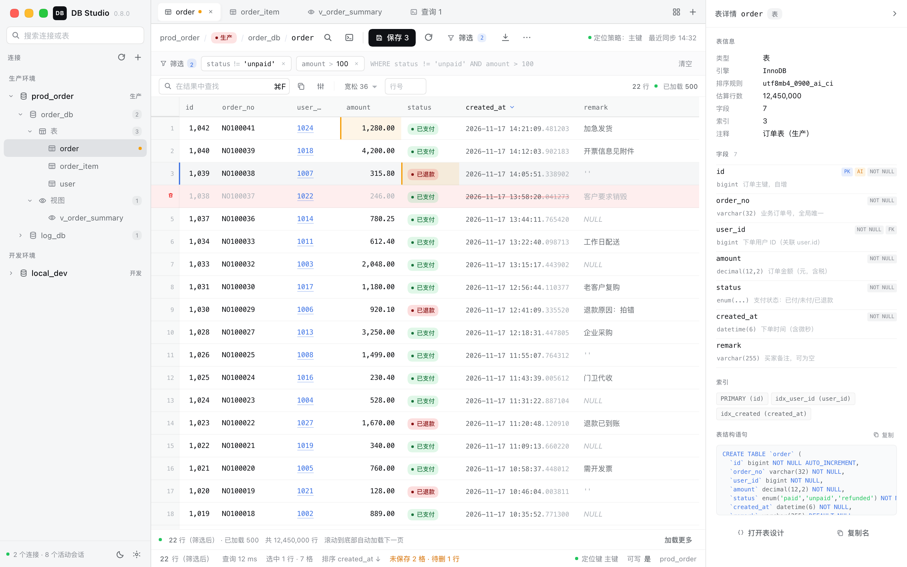
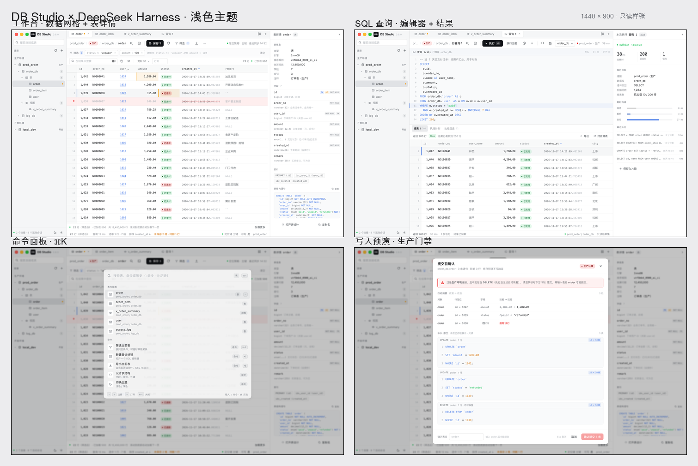

# DB Studio · DeepSeek Harness 风格界面案例

> **规范状态**：本案例已被 [`docs/design/UI-STYLE-GUIDE.md`](../../design/UI-STYLE-GUIDE.md) 收口为视觉基线。
> 规范与样张冲突时以规范为准；规范对样张做了两处适配：浅色强调色 `#3B6EDC`（可读性）、
> 标准行高 32px（样张展示的是宽松档 36px）。生产图标沿用现有 24 viewBox，不复制样张的 1.5 细线。

> **落地状态（2026-11-18）**：本案例的设计语言已随 **v0.9.0** 落到生产；生产截图见
> [`verify-light.png`](../verify-light.png) / [`verify-dark.png`](../verify-dark.png)。
>
> 本目录仍是只读样张：没有改 `apps/` / `packages/` 里的代码，也没有新增依赖。
> 全部文件都在本目录下，打开 `index.html` 即可看。

## 这是什么

从 DB Studio 里抽了四个主要界面，用 DeepSeek Harness（DSH）官方 UI 的语言重做一遍：

| 界面 | 对应产品里的位置 | 重做的重点 |
|---|---|---|
| 工作台 | 连接树 + 标签 + 数据网格 + 表详情 | 36px 行高、只画横线、黑主按钮、右栏表结构 |
| SQL 查询 | 查询标签 + 编辑器 + 结果集 | 代码块、结果标签、右侧执行摘要、执行计划 |
| 命令面板 | ⌘K 浮层 | 640px 玻璃面板、分组结果、键盘操作、`: / @` 模式 |
| 写入预演 | 保存前 SQL 预览 | 生产警告、改前→改后摘要、SQL 原文、表名门禁 |

四张图放一起看：

深色版：[overview-dark.png](shots/overview-dark.png)。单张原图在 `shots/`。

## 重要前提：DSH 没有可 import 的“官方组件库”

上一轮已经确认过：DSH 的 UI 插件只服务 DSH 自己的界面，官方文档也明确禁止第三方
`require` `@deepseek-ai/dsh-client-ui-primitives`。所以这里做的不是“装一个包变好看”，
而是把 DSH 的**设计语言**搬过来：

- 令牌名字和数值取自本机安装的 `@deepseek-ai/dsh-client-ui-theme`
  （`design-platform.css` / `base.css` / `focus.css` / `scrollbar.css` /
  `corner-shape.css`），落在 [tokens.css](tokens.css)；
- 控件是按官方组件源码的尺度**重写**的，不是 import 的：
  按钮 28 高 / 8 圆角、菜单 4px 内边距 + 12 圆角、树行 5px 内边距、
  0.5px 发丝线、5px 滚动条、`--dsw-focus-ring-width` 2px；
- 深色只重绑语义层，静态色板不动。

这套做法的好处是：以后真要把面板嵌进 DSH，`tokens.css` 里的变量名不用改，
宿主主题会覆盖同名变量。

## 设计决定（为什么它看起来像 DSH）

| DSH 的做法 | 在这个案例里的落地 |
|---|---|
| 主按钮是反色，不是品牌蓝 | 浅色黑底白字 / 深色白底黑字；一个视图只有一个主按钮 |
| 蓝色只给链接、焦点、选中条 | 选中行是灰底 + 2px 蓝色左条；树选中是灰底，不刷蓝 |
| 3 级文字 + 2 级边框 + 1 个强调色 | `label-primary / secondary / tertiary`，边框只用 `border-l1/l2` |
| 表格只画横线 | 无竖线、无斑马纹；hover 整行灰底，36px 行高 |
| 状态徽章 = 14% 状态色底 + 55% 混色文字 | 见 [components.css](components.css) 的 `.badge`；浅色对比度 5–7.7 |
| 浮层用 0.5px 描边 + `elevation-prominent` | 命令面板、菜单、预演对话框都不叠 border + 大阴影 |
| 圆角不是全站一个值 | tag 4 / 控件 8 / 面板 12 / 对话框 16 / 胶囊 999 |
| 代码用等宽字体，数字 `tabular-nums` | 列名、ID、金额、时间全走 `SF Mono` |

**没有紫色 / 紫蓝渐变**，没有 emoji 图标；图标全部是内联 SVG（`index.html` 顶部的
sprite），颜色跟 `currentColor`。

## 适配判断：哪里顺，哪里要取舍

### 顺的地方

1. **壳层几乎一一对应**：左树 / 标签 / 工具栏 / 数据区 / 状态栏，正好是 DSH
   的三栏 + 内容区结构；连接树可以直接套 DSH 的文件树行高和 hover。
2. **表格变干净了**：去掉竖线和斑马纹、行高从 28 提到 36、表头改 11px 等宽，
   信息密度没有明显下降，但“像工具”而不是“像网页后台”。
3. **右栏是 DSH 最像 DB 工具的一块**：字段列表、索引 tag、DDL 代码块，
   和 DSH 的详情面板/插件详情页是同一套排版。
4. **命令面板和写入预演**：DSH 的浮层语言（玻璃、0.5px 描边、12/16 圆角、
   footer 键盘提示）本来就适合这两种交互，不需要改结构。

### 需要取舍的地方

1. **DSH 比 DB Studio 松**。DSH 的表格行高 36，DB Studio 现在是 28。
   样张展示的是宽松档 36，但保留了行高选择（28 / 32 / 36）——真正落地时默认 32，
   36 仅作为用户可选的宽松档。
2. **DB Studio 的工具栏比 DSH 密**。工作台在 870px 里要放身份条、保存、刷新、
   筛选、导出、更多和定位策略；案例已经把低频项收成图标，仍然比 DSH 的
   设置页拥挤。窄窗口下 `toolbar-meta` 会自动隐藏（≤1280）。
3. **列名不能用全大写**。DSH 的表格标签喜欢 uppercase，但数据库列名是标识符，
   大写会改变语义（`order_no` ≠ `ORDER_NO`），所以列头保留小写等宽，
   只把分区标题（表信息 / 字段 / 索引）做成 10px uppercase。
4. **右栏宽度从 280 提到 320**。字段注释要常驻第二行，280 会频繁截断；
   320 在 1440 下给主区留 870，刚好放下 7 列。1280 时自动降到 292。
5. **对比度**：DSH 官方 `label-tertiary` 在浅色下约 3.71:1，11px 小字不满足
   WCAG AA。这是官方取值，案例照搬了；如果要对外或过审，在 `tokens.css`
   末尾覆盖成 `--dsw-static-neutral-bluish-700`（约 5.8:1）即可。
6. **没做的界面**：连接编辑器、表设计器、导入/导出向导、对象浏览清单
   不在这一轮四个界面里；它们可以用同一套 token 继续扩展，但这次没有画。

## 交互清单

打开 `index.html`（顶部有一条演示控制条；截图用 `?clean=1` 隐藏）。

- `1 / 2 / 3 / 4`：工作台 / SQL 查询 / 命令面板 / 写入预演
- `T`：浅色 / 深色
- `⌘K`：命令面板；输入即筛，`↑↓` 选择，`↵` 打开，`Esc` 关闭
- 命令面板里 `:` 切命令模式，`@` 切历史模式
- 左树：单击看详情，双击开标签；连接/库/类别可折叠；顶部搜索实时过滤
- 标签：切换、关闭；全部关掉会出现空态
- 网格：点行选中、点单元格看活动格、点列头排序、`⌘F` 聚焦查找
- 筛选：条件条删单条 / 清空；`⌘⇧F` 打开筛选浮层
- 列设置：显示/隐藏列；行高切换；输入行号回车跳转
- 保存：`⌘S` 打开写入预演；生产门禁要手动输入 `order`，确认后 3 条语句提交
- 查询：`⌘R` / `⌘⏎` 执行；结果标签切“结果 / 执行计划 / 执行历史”

## 验证情况

`node shots.mjs` 会重新生成 8 张 1440×900 @2x 截图（浅/深 × 四界面），
并把实测值写进 `shots/metrics.json`。当前结果：

- 8 张截图全部 `doc = 1440×900`，无页面横向/纵向溢出；
- 侧栏 240、右栏 320、标签条 38、工具栏 44、行高 36、表头 32；
- 命令面板 640 宽，10 条结果刚好放下（无截断）；
- 写入预演 760×805，body 674 高，全部内容可见；
- CSS 自定义属性：**0 个未定义引用**（172 个定义 / 122 个使用）；
- 浅色 / 深色两套语义 token 都解析成功；主按钮浅色 `#0f1115`、深色 `#f9fafb`。

做不到自动验证的部分：观感、对齐节奏、暗色浮层的“发光感”。
这一轮没有图像识别能力，截图需要你亲眼过一下；`index.html` 可以直接交互检查。

## 文件

| 文件 | 作用 |
|---|---|
| [index.html](index.html) | 四个界面的结构 + SVG sprite |
| [tokens.css](tokens.css) | DSH 令牌子集（浅/深） |
| [base.css](base.css) | 窗口壳层、侧栏、标签、工具栏、条件条、状态栏 |
| [components.css](components.css) | 按钮、输入、徽章、菜单、命令面板、对话框 |
| [screens.css](screens.css) | 网格、详情、SQL 编辑器、结果、执行计划 |
| [app.js](app.js) | 演示数据 + 全部交互 |
| [shots.mjs](shots.mjs) | 截图脚本（playwright-core，复用本机 Chromium） |
| `shots/` | 8 张界面图 + 总览图 + 现状对照图 + `metrics.json` |

## 如果真落地，建议顺序

1. **P0**：把 `tokens.css` 的语义 token 映射进现有 `styles.css`，先换色和边框；
   主按钮改反色，蓝色只留链接/焦点/选中条。
2. **P1**：三栏骨架 + 36/32 行高 + 只画横线 + sticky 表头 + 自定义滚动条；
   先做工作台和右栏，收益最大。
3. **P2**：命令面板和写入预演换成这套浮层语言；这两个是“精致感”的主要来源，
   而且不改业务逻辑。
4. **P3**：把表设计器/连接编辑器按同一套 `section-label / card / field` 规范补齐。

---

*案例目录：`docs/design-mockups/dsh-ui-case/`。没有修改产品代码，没有安装依赖。*