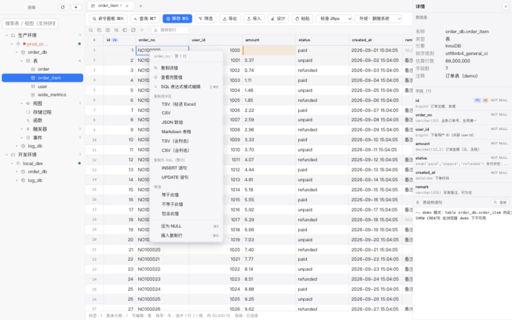
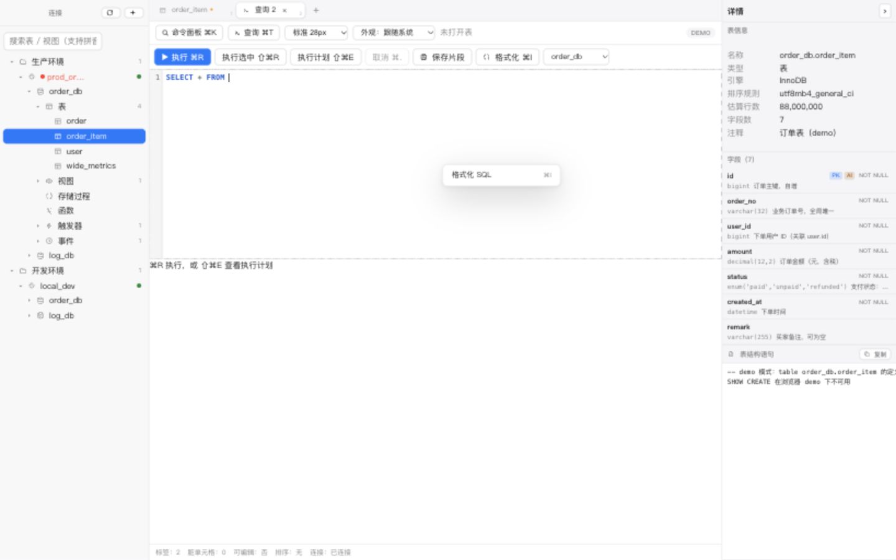
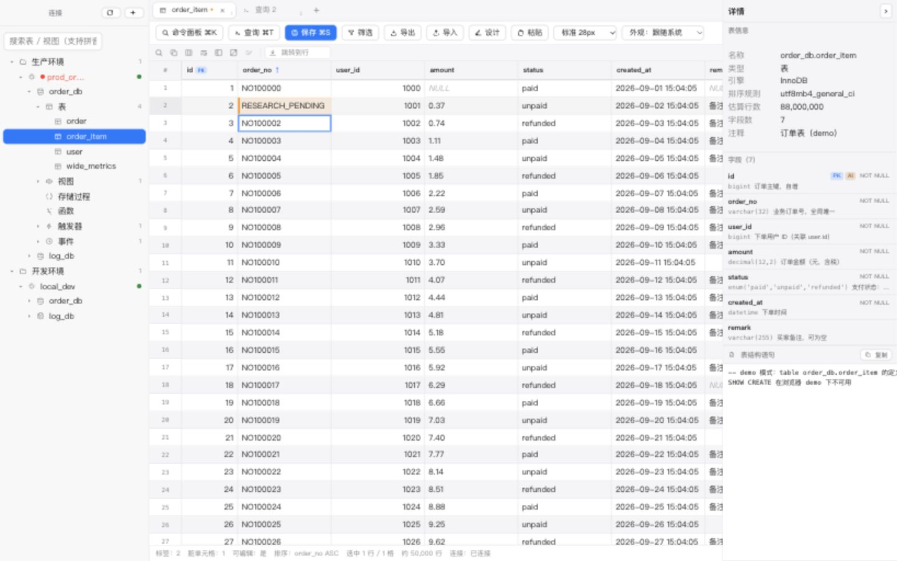
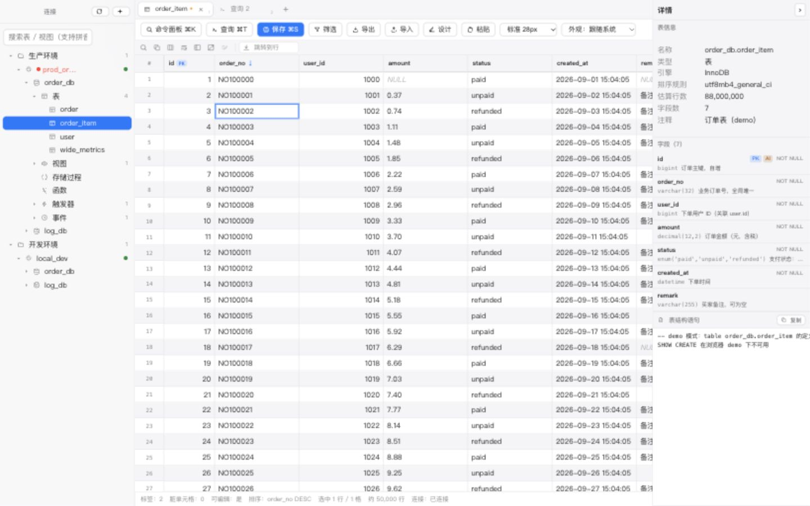
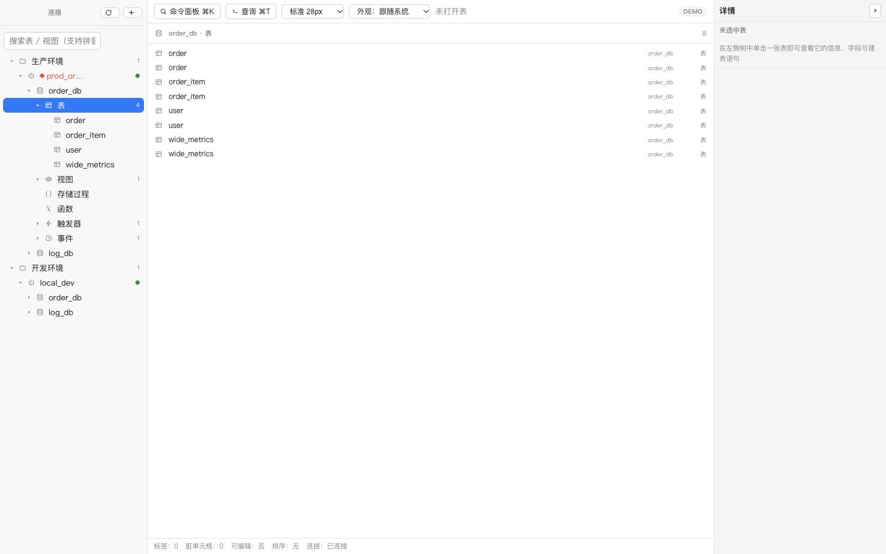

# DB Studio 项目全景与数据库 GUI 竞品深度调研

> 调研日期：2026-10-12。对象：当前 **0.6.0 工作区，包含已有未提交改动**。
> 本文是现有《竞品调研与功能路线图》的本轮证据附件，不另建一套生效路线图。下面的新增功能均为建议，尚未批准实现。

## 1. 结论与证据边界

**仍有很多值得迭代的内容，优先级高于立即增加 PostgreSQL 或 AI。** 当前已经有完整的连接、查表、筛选、编辑预演、SQL、导入导出和结构设计骨架；下一阶段的主要价值是让这些能力在连续操作中保持正确、可发现、可撤销、上下文清楚。

推荐顺序：**修正确性问题 → 补齐高频操作入口 → 增强值查看与编辑 → 完善查询和导出语义 → 再评估跨数据库战略。** 不建议按竞品功能数量追平，也不建议重做现有视觉风格。

本轮三种证据必须区别对待：

| 标记 | 含义 | 能说明什么 |
|---|---|---|
| UI 实证 | 本轮在 1440×900 浏览器 DEMO 中实际操作 | 说明渲染层行为；不能替代 Electron 菜单、真实驱动、真实写入验收 |
| 代码证据 | 阅读实现、入口、调用链和相关测试 | 说明实现和接线；未跑对应环境的情形不称为真机复现 |
| 官方资料 | 竞品官网、官方文档、官方项目资料 | 说明公开能力；不等于购买相应版本或在本机实际体验 |

范围索引覆盖 **55 份 Markdown 文档、166 份实现/测试/脚本/样式文件**，分别约 10,893 行与 66,973 行，见 [文件清单与内容指纹](evidence-2026-10-12/scope-manifest.json)。方法是全目录盘点与全文检索，重点逐段阅读产品规则、现行需求、发布记录、菜单、主要组件及连接—查询—编辑—提交—传输调用链。**不是对全部 6.7 万行做逐行安全审计，也不是每条功能都完成真实数据库验收。** `docs/archive/` 只用于识别沿革，不作为当前需求；构建产物、依赖源码和安装包不计入源文件阅读范围。

竞品覆盖 11 款：Navicat、TablePlus、DataGrip、DBeaver、Beekeeper Studio、Sequel Ace、MySQL Workbench、Postico、DbVisualizer、DbGate、TablePro。主对标是 TablePlus / TablePro，复杂值与 SQL 交互参考 DataGrip / DBeaver，MySQL 工作流参考 Navicat / Sequel Ace / Workbench；Postico 是 PostgreSQL 方向参考，不算当前 MySQL 同类替代品。

不沿用旧报告的“性能 5 分、原生观感 5 分、安全 5 分”排名。本轮没有竞品同机基准，没有证据证明 DB Studio 在这些维度最强。安全预演也不是独有能力，TablePlus、DataGrip、Workbench、TablePro 都有相关机制。[T2][G1][W1][P2]

## 2. 项目目标、演进与工程现状

### 2.1 什么才算有价值的迭代

目标用户是间歇性查看、定位和少量修改数据的 macOS 开发者。核心路径是：**打开应用 → 连接 → 找到对象 → 缩小数据范围 → 看懂值 → 修改少量字段 → 核对 SQL → 提交**。

优先衡量四件事：找到目标所需动作数、用户能否识别当前连接/库/表、改动是否可靠保留、等待和内存成本是否可控。功能多但增加启动负担、误操作概率或认知成本，不符合定位。

必须保留：简体中文、Apple 原生精修风格、系统字体、蓝灰色系、内容区不透明、原生交通灯、只解可视区、CodeMirror 懒加载、主进程只读守卫、主键/唯一键安全定位、脏单元格级更新、写入前预演、BIGINT/NULL/微秒保真、真取消。

明确排除：同步/跨库传输平台、ER 建模、BI、任务调度、DBA 权限和服务器监控、团队账户/云同步、跨平台、多语言、存储过程调试器。完整 Form View 是原 PRD 延后事项；本轮优先建议完善已有单值弹窗，不将整行表单编辑偷偷纳入。

### 2.2 文档的权威与时效

| 文档组 | 本轮吸收的主要约束/事实 | 使用注意 |
|---|---|---|
| AGENTS / 根 README / 包 README | 架构分层、红线、双 tsconfig、构建与运行方法 | README 中的完成状态仍需对代码核实 |
| PRD v1.0 | 产品定位、非目标、核心功能与性能预算 | 早期目标不等于现在实测；与新缺陷结论冲突时看后续更正 |
| v1.1、v1.2 与 SQL 增强 REQ | 网格、对象、导入导出、编辑器增量 | “已交付”是当时状态，仍有组合交互缺口 |
| 窗口 REQ、v1.3 缺陷清理 | 原生灯配置、筛选真值、详情与完整值分离、断线恢复 | 旧“frame:false 下有灯”已被证伪 |
| 技术评审、Spike、S0 | 列式 IPC、utilityProcess、xlsx 保真、格式化体积取舍 | Spike 是限定场景历史实验，不能直接当当前产品完整基准 |
| 10 篇 devlog | 从纯逻辑到 IPC 接线，再到真机修复的过程 | 早期“未做”可能已被后续版本完成 |
| RELEASES | 0.1→0.6 的功能和验收记录 | 0.6 总表“待发”和正文“已安装”不一致；单测、UI 数字也有多套 |
| 旧竞品主文档 | 历史 A～G、V1～V28 编号与非目标 | 主观评分、完成度推断、唯一剩余 PG/AI 的结论需要更正 |
| design-mockups / spike | 风格探索、真实截图、性能探针和可复现脚本 | 图片是特定时间快照，不证明当前所有入口正常 |
| archive | 旧需求和编号的追溯背景 | 不以它恢复已被否决的范围 |

另有两个文档治理点：旧主文档写了 Zustand，但当前依赖和主要状态代码不能据此认定在使用 Zustand；别名实际还有 renderer Vite 的解析配置，新增子入口不能仅核对三份配置。这里只记录，不修改工程约定。

### 2.3 实现地图

| 层 | 主要职责 | 本轮核对重点 |
|---|---|---|
| core-connection / secret / ssh-tunnel | 连接模型、生命周期、凭据与隧道 | UI 选项是否接到安全和资源释放链路 |
| core-driver-mysql / schema-cache / tree-view | MySQL 查询、元数据、快照、对象树 | 默认库/同名库上下文、刷新、六类对象 |
| core-ipc-codec / grid-view | 列式传输、可视区、选择、导航、排序 | UI 虚拟化与结果集整体内存并非同一问题 |
| core-mutation / sql-guard / sql-ident | 只更新脏字段、安全定位、冲突与只读判断 | 所有 UI 写入口必须沿同一条链路 |
| core-clipboard / filter | 格式转换、粘贴校验、参数化 WHERE | 空串/NULL、选区/整行、条件草稿/生效值 |
| core-sql-editor / history / command-palette | 分句、格式化、提示、历史/片段与导航 | SQL 结果编辑实际边界、片段作用域 |
| core-import / export / table-designer | 文件流、导入计划、DDL 差异 | 文件取消语义、预演、非标准标识符 |
| main session-registry / ipc-handlers | 真实会话、只读防线、执行与取消、数据推送 | Electron 与 DEMO 差异、写入确认之后的执行 |
| main transfer-manager + 三个 worker | 导入、导出、脚本的独立进程任务 | 真取消、进度、失败报告、已执行部分是否保留 |
| App + backend + 各 renderer 目录 | 多标签、工具栏、弹窗、菜单与上下文协调 | 入口存在性、回调是否接线、刷新是否丢状态 |

### 2.4 本轮实际验证结果

| 检查 | 本轮结果 | 边界 |
|---|---|---|
| 两套 TypeScript 检查 | 通过 | 根与 renderer 均执行 |
| 单测 | 50 文件、1,639 项通过 | 单测不能覆盖原生快捷键优先级和所有连续操作 |
| 体积门禁 | 9/9 | 首屏 448.9KB / 1465KB；编辑器 132.7KB / 150KB gzip；功能弹窗 36.5KB / 60KB gzip |
| `npm run verify` | **未通过完整链条** | 沙箱外重跑后，e2e 首步 `ECONNREFUSED 127.0.0.1:13306`；未启动 fixture，不把后续专项视为通过 |
| `npm run e2e:ui` | **226/226 通过** | DEMO 浏览器；控制台错误检查通过 |
| 本轮手工交互 | 对象列表、表格、菜单、完整值、排序、查询页 | 已复现对象范围混入和排序清除脏数据，详见 §5 |
| 安装包、交通灯、真实写入 | 本轮未重新验收 | 不复用历史通过数字冒充本轮结果 |

完整记录：[verify 日志](evidence-2026-10-12/verify.log)、[UI 日志](evidence-2026-10-12/ui.log)。本轮未改业务代码，未操作用户真实业务库，未安装或购买竞品。

## 3. 已实现功能与边界清单

下表“已有”表示能在当前实现找到入口和逻辑，不代表该能力在所有组合操作中均已验证。菜单的逐项清单另见 §4。

### 3.1 连接、对象与工作区

| 编号 | 功能点 | 当前实现与边界 |
|---|---|---|
| C01 | 新建/编辑/删除连接 | 连接表单、测试连接、保存、保存并连接；修改未保存有退出处理 |
| C02 | 数据库类型 | 当前支持 MySQL；其他类型置灰“即将支持”，不是已兼容 |
| C03 | 基础参数 | 名称、主机、端口、用户名、密码、默认库、备注 |
| C04 | 连接组织 | 嵌套分组、颜色标签、生产环境识别；没有分组拖拽管理 |
| C05 | 凭据 | safeStorage 密文；不可用/用户要求时每次手输；不落明文 |
| C06 | SSH | 密码、私钥文件、私钥口令；权限检查与隧道释放；没有多跳配置 |
| C07 | TLS | CA、客户端证书/私钥路径和证书校验开关；无完整证书选择向导 |
| C08 | 连接只读 | 配置、命令入口、主进程 SQL 守卫；UI 禁用/状态口径仍需统一 |
| C09 | 生命周期 | 空闲断开、推送状态、重连横幅、读取前 ensure；不能只看树是否仍存在 |
| C10 | 配置迁移 | 没有连接导入导出 UI；连接 URI 粘贴/从其他工具迁移未见实现 |
| O01 | 树层级 | 分组→连接→库→类别→对象；展开状态记忆 |
| O02 | 六类对象 | 表、视图、过程、函数、触发器、事件；不是六种完整设计器 |
| O03 | 搜索 | 模糊匹配、有限拼音首字母、字段名反查表；不是全库内容检索 |
| O04 | 收藏 | 星标表、命令面板加权；没有完整收藏管理页 |
| O05 | 元数据缓存 | 7 天快照；0.6 增加后台回源、变化推送与脚本结束刷新 |
| O06 | 多选对象 | Cmd 点选、Shift 区间、批量删除；类别“全选本组”接线需核实 |
| O07 | 中央对象清单 | 无打开标签时按树选择展示；有同名库跨连接混入问题；未提供自己的搜索/排序/右键 |
| O08 | 对象定义 | SHOW CREATE、复制 DDL、打开到查询页；过程/函数浏览不等于调试 |
| O09 | 详情面板 | 表信息、字段类型/主键/注释、DDL；树选中优先于活动标签，需让上下文更醒目 |
| O10 | 拖表到编辑器 | 结构化拖拽与带库前缀的转义名称；不等于拖入 SQL 文件编辑 |
| W01 | 多标签 | 表、查询；关闭按钮、中键关闭、快捷键切换；表切换保留 DOM、滚动和脏数据 |
| W02 | 标签管理 | 没有右键、拖动排序、置顶、关闭其他/右侧、重新打开关闭标签 |
| W03 | 多窗口 | 当前表在新窗口打开，有数量上限；不是拖标签出窗口或自由分屏 |
| W04 | 恢复 | 会话快照和 SQL 草稿恢复，过滤已删除连接；不等于恢复未提交数据改动 |
| W05 | 状态栏 | 行数/耗时、选择统计、脏格、排序、筛选、连接等；只读与来源语义待完善 |
| W06 | 布局 | 三栏、分隔拖拽、详情收起、主题、行高和字体档位 |

### 3.2 网格、筛选和修改

| 编号 | 功能点 | 当前实现与边界 |
|---|---|---|
| D01 | 虚拟网格 | 只渲染可视区+缓冲，列式解码，固定行高，数据等宽字体 |
| D02 | 行数控制 | 表查询默认 3000 行，“加载更多”增加 LIMIT 后重新查询前缀；不是游标续传 |
| D03 | 截断提示 | 显示已加载/可能更多/估算总行数；估算不代表 COUNT 精确值 |
| D04 | 选择 | 单格、矩形拖选、行号、Cmd 多行、Shift 范围、键盘扩选、递进选区 |
| D05 | 导航 | 方向键、边界跳转、跳到行、列快速定位；行号是已加载结果的位置 |
| D06 | 排序 | 无→升→降、Shift 多列、序号标记、服务端 ORDER BY；排序重载会影响脏数据 |
| D07 | 列宽 | 拖宽、双击自适应；不是在所有行上无限扫描求最大宽度 |
| D08 | 列布局 | 隐藏/显示、至少留一列、冻结到当前列、取消冻结；无拖拽列重排 |
| D09 | 显示辅助 | 类型开关、列注释 tooltip、JOIN 来源提示、分组条纹、换行、转置只读 |
| D10 | 本地查找 | 在已加载结果查找；不能替代服务端 WHERE 检索全部数据 |
| D11 | 编辑 | 双击/Enter、单行输入框、Enter/Tab/失焦标脏、Esc 取消编辑；不是立即写库 |
| D12 | 类型专用编辑 | 有 FK 候选和表达式模式；未见 ENUM/SET、日期时间专用单元格编辑器 |
| D13 | NULL | 专用快捷键/菜单，与空字符串区分；EMPTY/DEFAULT 缺少对等显式入口 |
| D14 | SQL 表达式 | NOW() 等显式表达式模式，预演 fx 警示；不可静默把普通文本变 SQL |
| D15 | 批量同列修改 | 多行同列填写、Apply/Discard，仍走脏格和保存预演 |
| D16 | 新增行 | 有复制行、粘贴追加；明显的“新增空白行”菜单/工具栏入口不足 |
| D17 | 删除行 | Cmd+Backspace 接保存预演；单元格/行号右键没有同等清晰入口 |
| D18 | 撤销 | 编辑态取消、本格清除、批量 Discard；不是跨多次编辑的完整网格 undo/redo |
| D19 | 粘贴 | TSV/CSV/Excel HTML 解析、列对齐校验、追加行和批量上限；没有正式导入那样的完整映射 UI |
| D20 | 复制 | 值、选区 TSV/CSV/JSON/Markdown、含列名、整行 INSERT/UPDATE；没有单列复制 IN 清单 |
| D21 | 行定位 | 主键或可用唯一键，否则只读；无键表不能“仿竞品强行编辑” |
| D22 | 提交 | 只提交脏单元格，SQL 预演，参数执行，WHERE 携带原值条件，事务与影响行数统计；冲突结果判定未接入实际提交链，见 R15 |
| D23 | 保存预览 | SQL、拒绝原因、表达式标记、展开全部；没有旧值→新值列表、逐条勾选提交 |
| D24 | 数据刷新 | 排序、筛选、快速筛选、刷新、加载更多、外键定位汇入 loadTable；缺少统一未保存保护 |
| F01 | 筛选构建器 | 按类型选择操作符，AND/OR、分组、区间/列表/NULL，参数化 WHERE |
| F02 | 筛选草稿 | 打开时复制当前条件；应用后生效，取消丢草稿；统计只数有效条件 |
| F03 | 保存筛选 | 按表保存、命名/重命名/搜索/删除；不等于列宽/排序共同保存的完整表视图方案 |
| F04 | 单元格快筛 | 等于、不等于、包含、NULL；多选值转 IN、列头直接添加筛选缺口明显 |
| F05 | 筛选反馈 | 徽标、状态和 SQL 预览已有；条件不常驻网格上方，回看/移除单条件成本仍高 |

### 3.3 值、图片与显示

| 编号 | 功能点 | 当前实现与边界 |
|---|---|---|
| V01 | 完整值 | 独立弹窗；当前传的是 `source.raw` 原值，未标明与脏值差异 |
| V02 | 长文本 | 展示和复制；未提供多行编辑、弹窗内查找、行列位置等 |
| V03 | JSON | 原文/格式化/语法着色/复制；`JSON.parse→stringify` 有大整数精度风险 |
| V04 | JSON 大值 | 格式化阈值按字符长度；没有树折叠、路径复制、节点查找、编辑校验 |
| V05 | 二进制 | Uint8Array/ArrayBuffer；HEX 预览前 2048 字节；可保存完整文件 |
| V06 | 图片 | 按魔数识别 PNG/JPEG/GIF/WebP；预览上限 8MiB |
| V07 | 图片交互 | 缺少 100%/适应窗口/缩放、像素尺寸、图片/HEX 切换、明确损坏图回退 |
| V08 | BLOB 编辑 | 查看/下载已有；没有从文件替换并进入脏格预演的完整链路 |
| V09 | URL/base64 图片 | 未见显式预览入口；不建议自动联网加载数据库内 URL |
| V10 | 时间/数字显示 | 保留原始值优先；时间戳换算、时区辅助、数字临时格式预览尚无专门面板 |

### 3.4 SQL、设计器与文件任务

| 编号 | 功能点 | 当前实现与边界 |
|---|---|---|
| Q01 | SQL 编辑器 | CodeMirror lazy、MySQL 方言、补全、高亮、注释、查找和编辑撤销 |
| Q02 | SQL 辅助 | 表/字段提示、类型信息、lint、自研显式格式化；不等同数据库服务端语义完全校验 |
| Q03 | 执行 | 全部/选中执行、逐句结果、耗时、取消、错误定位；目标库可选 |
| Q04 | 结果标签 | 多结果、关闭、行数/耗时/截断提示、导出；缺少固定/重命名/关闭其他等管理 |
| Q05 | 查询结果编辑 | **结果网格始终只读**；“打开可编辑表格”只传连接/库/表，没有保留原查询 WHERE/选中主键 |
| Q06 | 结果排序 | 查询结果明确 `sortable=false`，不是与表浏览等价的可排序结果网格 |
| Q07 | 大结果 | 虚拟网格控制 DOM；普通查询仍把结果收集后编码，不代表内存无界问题已解决 |
| Q08 | EXPLAIN | JSON 计划、树/表展示、风险着色、异常降级；没有完整性能诊断平台 |
| Q09 | 历史 | SQLite 存储、搜索、星标、删除；IPC 定义裁剪保留 1000，不能沿用旧文档任意数量 |
| Q10 | SQL 片段 | 0.6 按连接/库/名称归属；命令面板仍仅用名称标识，存在跨库同名风险 |
| Q11 | 草稿 | 本地自动恢复；当前无规范的 .sql 打开/另存为文件编辑闭环 |
| Q12 | SQL 参数 | 未见命名参数表单、绑定值输入和安全历史脱敏流程 |
| Q13 | SQL 右键 | 当前只有“格式化 SQL”；复制、执行选中、EXPLAIN 等未组成完整右键菜单 |
| S01 | 表设计 | 新建/改名、列属性、索引、外键、表选项、DDL diff/完整 SQL、预览执行 |
| S02 | DDL 安全 | 不应把 MySQL DDL 批次当成可原子回滚的普通 DML；批量删表失败反馈需专项核对 |
| X01 | 导出格式 | XLSX/CSV/JSON/SQL/Markdown，进度、耗时、字节数、取消 |
| X02 | 文本导出 | 分隔符、UTF-8/BOM、NULL 标识、表头；非完整任意编码系统 |
| X03 | 导出范围 | 表/筛选表、自定义查询、部分格式整库；缺少统一“选区/已加载/全部匹配/仅可见列”口径 |
| X04 | 查询导出 | 传递 SQL 后在 worker 重查；不等于导出当前结果快照，易遇数据变化/NOW/RAND 差异 |
| X05 | 手动备份 | 有整库 SQL/Markdown 范围；不等于 mysqldump 全部一致性、例程、事件、权限语义 |
| X06 | 数据导入 | CSV/TSV/XLSX/JSON 对象数组、预览/映射/校验、追加 INSERT、错误报告及失败行重试 |
| X07 | 导入取消 | 已插入部分保留，有明确提示；不是全文件事务回滚 |
| X08 | SQL 文件执行 | 连接/库/表入口、选文件、UTF-8/GBK、扫描摘要、DELIMITER、遇错停止/继续、进度与真取消 |
| X09 | SQL 脚本提速 | 0.6 有事务分批和连续 INSERT 合并；发布记录的 10 倍仍标为外推，不能当真实同机胜过 Navicat |
| A01 | 原生壳 | macOS 菜单、About、偏好设置、缩放、交通灯和多窗口 |
| A02 | 更新 | 有检查逻辑；发布记录明确缺 publish/app-update 配置，不能称自动更新完整交付 |
| A03 | 设置 | 主题、字号、行高、关闭脏数据确认、快捷键展示等；不是可编辑键位配置中心 |

## 4. 菜单、快捷键与操作入口逐项核对

### 4.1 macOS 顶部原生菜单

证据：`apps/desktop/src/main/menu.ts`、`App.tsx` 原生菜单命令订阅。共 **19 条自定义命令**，另有系统 role 项。以下列出应用自定义文案；系统 role 由系统本地化决定。

| 菜单 | 当前项目 | 本轮判断 |
|---|---|---|
| DB Studio | 关于、偏好设置、检查更新、系统隐藏/退出等 | 基本壳完整；更新链未配置 |
| 文件 | 新建连接、新建查询标签、关闭标签 | 缺少打开 SQL 文件、另存为 SQL；是否增加以文件工作流需求为准 |
| 编辑 | 系统撤销/重做、剪切/复制/粘贴、全选 | 网格自定义 DOM 与系统编辑 role 协调需真 Electron 测试 |
| 视图 | 命令面板、保存修改、筛选、导出、导入、设计表、刷新表结构、字体放大/缩小/重置、切主题 | 修改数据动作混入视图；静态菜单缺少按焦点/对象动态可用性 |
| 窗口 | 最小化、缩放、新窗口打开当前表、前置、上/下标签 | 没有标签批量管理；新窗口不是新的独立连接工作流 |

建议先统一“同一个动作在原生菜单/工具栏/右键/快捷键”的分派和禁用原因，再考虑把查询和数据操作从“视图”中分组移出；不要为了像 Navicat 而一次增加很多顶层菜单。

### 4.2 当前快捷键冲突与语义

| 键 | 原生菜单 | 局部界面 | 判断 |
|---|---|---|---|
| ⌘R | 刷新表结构 | SQL 执行全部 | 同键异义，原生菜单会优先拦截；代码确认，需 Electron 按实体键复核 |
| ⇧⌘E | 导出数据 | SQL 执行计划 / 网格表达式模式 | 同键三个动作；浏览器测试不能证明桌面正确 |
| ⌘0 | 重置字体 | 网格设为 NULL | 数据动作与外观动作冲突，应优先消除 |
| ⌘S | 保存当前表修改 | SQL 使用自动草稿/保存片段按钮 | SQL 页缺乏清晰 ⌘S 语义；不能无反馈 |
| ⌘C/V/A/Z | 系统编辑 role | 自定义网格的复制/粘贴/选择 | 列为真机待验，不直接认定全部失效 |
| ⌘I | 无同名全局分派 | SQL 格式化 | 当前实现是 ⌘I，**不是** ⇧⌘F；避免按印象列冲突 |
| ⌘1～9 | renderer 标签跳转 | 标签总数 ≤9 时启用 | 超过 9 个时前九个也失效的条件值得调整 |
| F2 | 无 | 树表对象进入设计器 | 文案“重命名”实际是进入设计器，不是树内编辑 |

验收要按“焦点在树/网格/单元格输入/SQL/弹窗”逐格测试；同一键同一时刻只能触发一个动作。旧 PRD 快捷键不能覆盖当前代码事实。

### 4.3 主界面工具栏

| 区域 | 已有入口 | 应改进的具体问题 |
|---|---|---|
| 主工具栏 | 命令面板、查询；表激活时保存/筛选/导出/导入/设计/粘贴；行高/外观 | 高频“刷新数据、加空白行、删选中行”没有同等明显入口；连接名不够醒目 |
| 网格小工具栏 | 结果查找、复制、列管理、换行、冻结、转置、批量编辑、跳行 | 图标密度高，需要统一 tooltip/禁用原因；“本地查找”明确注明范围 |
| SQL 工具栏 | 执行、执行选中、EXPLAIN、取消、保存片段、格式化、目标库 | 应显示目标连接与环境；执行全部/当前语句/选中的语义直观可辨 |
| 底部 | 行数、估算、加载更多、统计与状态 | 加载更多并非仅追加；未保存时应先处理编辑，行数状态区分精确/估算/截断 |

### 4.4 树右键

| 右键对象 | 当前可见或装配的菜单动作 | 缺口/建议 |
|---|---|---|
| 空白/分组 | 新建连接 | 分组管理低频，暂不扩展复杂拖拽体系 |
| 连接 | 连接/断开、新建查询、编辑连接、运行 SQL 脚本、刷新、删除连接 | 增加“复制连接信息（脱敏）”可选；生产环境名称完整显示优先 |
| 数据库 | 新建查询、新建表、运行 SQL 脚本、复制库名、刷新 | 库级备份如确需，可复用已有导出，不另造任务体系 |
| 类别 | 表类别可新建表、刷新；TreeView 有全选本组构造逻辑 | App 类别分支未合并 extras，应补入口接线验证 |
| 表 | 打开、设计、导出、导入、运行脚本、复制名称；定义/DDL/INSERT 模板/收藏；清空/删除；多选批删 | 打开新查询并插入 SELECT、复制完整限定名是高价值小增量；危险项应单独分隔 |
| 视图/过程/函数/触发器/事件 | 打开、查看定义/复制 DDL 等，按类型提供 | “打开表”泛用文案不准确；不要出现对象不支持的动作 |

树与中央对象列表应复用同一语义，不能左侧有右键、中央同一对象没有；所有对象必须携带 `(connId, database, kind, name)`，不得仅凭同名库定位。

### 4.5 单元格、行号、列头、标签与 SQL 右键

| 位置 | 当前菜单 | 下一步最小补齐 |
|---|---|---|
| 单元格 | 复制该值、查看完整值、外键跳转、表达式、条件满足时批量编辑、TSV/CSV/JSON/Markdown/含列名、整行 INSERT/UPDATE、等于/不等于/包含快筛、NULL、清除本格改动、复制行 | 加入“编辑值…、设为空串、使用默认值、撤销本格”；将复制格式收进子菜单 |
| 行号 | 行选择与整行复制语义接现有网格菜单 | 独立突出新增/复制/删除/撤销选中行；不要默认把首列值当作用户操作目标 |
| 列头 | 升/降/清排序、复制列名、冻结到此列、宽度自适应、隐藏、显示类型、分组着色 | 加“按此列筛选、复制限定列名、恢复列布局”；后续再评估列重排 |
| 表/查询标签 | 关闭按钮和中键，**没有右键菜单** | 关闭其他/右侧、复制表身份、在树定位；批量关闭只出现一次汇总确认 |
| SQL 编辑器 | **只有格式化 SQL** | 执行选中/当前、EXPLAIN、复制、粘贴、注释；不要剥夺基础文本菜单 |
| SQL 结果标签 | 关闭按钮 | 固定结果、重命名、关闭其他、复制 SQL；结果越多越需要来源标识 |

通用菜单交互也需要迭代：树/网格菜单有边界钳制、点击外部/Esc 关闭；未见完整的方向键巡航、Home/End、焦点进入与返回。SQL 菜单还未复用相同的边界处理。建议先把这一套基本交互做齐，再加新动作。

本轮右键实证：

## 5. 本轮发现：先处理这些，再排新功能

以下是产品调研中发现的实现问题，不是已经修复的变更。优先级表示建议处理顺序；安全边界类必须先写失败用例再修。

| 编号 | 级别 / 证据 | 现象与代码定位 | 后续验收标准 |
|---|---|---|---|
| R01 | P0 / UI 实证+代码 | 有脏格时点列头排序，脏格从 1→0，无确认。`App.onSortChange→loadTable` 替换 payload；`useGridDataSource` 重建空 dirty Map | 排序/筛选/刷新/加载更多/FK 跳转逐一覆盖；用户取消时原改动、选区、状态不丢；可选择先保存或明确放弃 |
| R02 | P0 / UI 实证+代码 | 选择 prod_order 的 order_db/表，左树 4 表，中央出现 8 表和重复名称。`ObjectBrowser.collectObjects` 只比较 database，未比较 scope.connId | 两连接同名库同名表，列表仅来自选中连接；跨连接总览显示连接名 |
| R03 | P0 / 代码 | 树库行新建表回调仅传 database，App 用第一个含同名库的连接。可能把设计器指向另一环境 | 从指定连接显式传 connId；多连接同名库，预演目标严格一致；不执行真实 DDL 来冒险证明 |
| R04 | P0 / 代码+最小数值机制 | `CellValueModal` 的 JSON.parse/stringify 会把 `{"id":9007199254740993}` 格式化为 `9007199254740992`；原文仍保留，但格式化显示/复制会失真 | 超 2^53、长小数、指数、重复键原文不变；格式化只改变空白或明确退回原文 |
| R05 | P1 / 代码 | ⌘R、⇧⌘E、⌘0 的原生菜单与局部命令冲突，见 §4.2 | 真 Electron 的五种焦点场景均执行唯一正确动作 |
| R06 | P1 / 代码 | 片段已按连接/库/名称唯一，`snippetToCommand` ID/action 仍只有 name，选择时 `.find(name)` | 同名片段跨两库/两连接/全局均能准确搜索、显示归属和插入正确 SQL |
| R07 | P1 / 代码 | 保存预览 `fillParams` 用正则替换全部问号；标识符/表达式字面量中的 `?` 也会被当占位符 | 名称含问号、字符串问号、反斜线、二进制参数等，预览准确反映执行含义；保持参数绑定 |
| R08 | P1 / 代码 | 筛选导出在 `ExportModal` 手拼库表反引号，未用 core-sql-ident | 含反引号、空格、Unicode 的库表导出 SQL 正确；不据此未经验证宣称存在可利用注入 |
| R09 | P1 / 代码 | 批量 DROP 按组执行，失败后仍关闭所有 targets 标签；统计按组成功，可能掩盖 DDL 部分成功 | 一组中第二个对象失败时刷新真实状态、逐对象报告；只关闭确认删除的对象；不能许诺事务回滚全部 DDL |
| R10 | P1 / 代码 | 只读连接有后端防线，但工具栏保存/导入/设计、可编辑状态等没有统一按连接只读显示 | 入口明确禁用原因；“有定位键”和“当前可写”分开；后端防线不减弱 |
| R11 | P1 / 代码 | 查询结果“打开可编辑表格”丢失原 WHERE/结果行上下文 | 先准确文案“打开源表”；如增强，限单表安全映射并定位目标主键，不直接重用任意结果写入 |
| R12 | P2 / 代码 | “查看完整值”传原值，即使网格显示待提交的新值；用户可能复制到旧值 | 显式区分库中原值/当前待提交值；复制按钮说明对象 |
| R13 | P2 / 代码 | TreeView 类别 extras 与 App 类别菜单装配不一致；“全选本组”可能没有真实入口 | 对类别实际右键验证，不以函数存在当交付 |
| R14 | P2 / 已有发布记录+代码 | 检查更新缺发布配置；现有“检查更新”不能形成完整升级闭环 | 自用可先准确提示和手动下载入口；公共发行再做签名、公证和更新链 |
| R15 | P0 / 代码 | `interpretResult` 仅定义及测试，无业务调用；`applyMutation` 累加 affectedRows 后 COMMIT，UI 无条件清空草稿。某行原值冲突命中 0 行时，其余更新仍提交，用户只看到总影响行数 | 区分逐行 DML 与 DDL 的结果契约；编辑 UPDATE/DELETE 必须逐条核对预期行数，异常在 COMMIT 前处理；冲突行保留草稿并可重载比较；真库构造并发修改与多语句部分冲突 |
| R16 | P1 / 代码 | SQL `ResultGrid` 没有传 `onInspectCell` 或 `onCellActivated`，其通用网格菜单“查看完整值”两条分支均无回调；表网格有弹窗不代表 SQL 结果也有 | SQL 结果长文本、JSON、二进制可打开同一值查看器；菜单无回调时不能显示成可用 |

R01 复现步骤：在 DEMO 表中双击 `NO100001`，输入 `RESEARCH_PENDING`，按 Enter 标脏，不点保存；再点 `order_no` 列头排序。无确认提示，脏格从 1→0，修改值消失。附加现象是标签仍可残留脏点，说明 source 与工作区 dirtyCount 的状态也需要一起统一。

本轮还没有验证的风险：并发查询响应先后导致旧结果覆盖新结果、多个大结果标签累计内存、连接只读状态切换时既有编辑、图片解码失败回退、脚本事务分批遇 DDL/用户事务语句的边界。这些需要专项用例，不作为已复现缺陷计数。

## 6. 竞品地图与各自值得学习的部分

只记录官方明确公开的能力。没有检索到不代表没有实现；下表不是软件评分榜。商业软件的功能还可能受版本、数据库引擎和操作系统限制。

| 产品 / 核验口径 | 与本项目的关系 | 最值得借鉴 | 不应照搬 |
|---|---|---|---|
| TablePlus / 当前官方文档 | 原生 Mac 数据查改的直接参考 | 快筛、值操作菜单、Review、安全模式、独立分屏 [T1][T2][T3][T4][T6] | 多数据库、插件、监控不是本轮范围 |
| TablePro / 当前官网与公开仓库 | 新增的直接对标，原生 macOS，免费核心+付费功能 | 单值类型编辑、预览 SQL、撤销、连接上下文、查询结果编辑 [P1][P2][P3] | 同步、团队、Agent/MCP 不等于项目必须增加；厂商性能数字不参与排名 |
| Navicat 18 / macOS 官方手册 | MySQL 工作流与完整商业工具参考 | 表视图配置、字段编辑、对象组织；Grid/Form、分页和单值编辑 [N1][N2] | BI、建模、数据/结构同步、脱敏、调度超范围 |
| DataGrip / 2026.2 帮助文档 | SQL 与结果集操作深度参考 | 值编辑、转置、JSON 树、表达式、上下文动作和提交控制 [G1][G2][G3] | IDE 级工程管理和大量工具窗口不适合直接搬入 |
| DBeaver / 当前官方文档 | 广泛类型、筛选与复杂值参考 | 值侧栏、引用关系面板、筛选/对象过滤、显示配置 [D1][D2][D3][D4] | CE/PRO 不能混为一个版本；任务/监控/建模不要引入 |
| Beekeeper Studio / 当前文档 | 简洁网格与现代交互参考 | JSON 编辑校验、显式新行、复制 IN、结果编辑和参数输入 [B1][B2] | 不照搬其排序/筛选可能丢暂存修改的行为；官方也明确提示这个限制 |
| Sequel Ace / 官方文档 | 最接近“只做 Mac + MySQL”的边界参考 | 连接收藏、查询收藏、当前语句执行、原生快捷键习惯 [S1][S2] | 不以“维护模式”贬低，旧报告该断言未核实；动态 shell 片段也无必要照搬 |
| MySQL Workbench / 官方手册 | MySQL 查询结果工作流参考 | 结果标签固定/改名/关闭其他、字段读写文件、Apply 前预演 [W1][W2] | 运维、建模与迁移工具不属于 DB Studio 的目标 |
| Postico 2 / 官方产品页 | PostgreSQL 单库原生产品参考 | 专注范围、FK 选择、细节面板、SQL 文件组织和自动保存 [O1] | 不支持当前 MySQL 任务，不作为直接功能对等评价 |
| DbVisualizer / 官方 26.2 文档 | BLOB、图片与值查看专项参考 | 值查看器按内容切换；原始二进制与显示分离 [V1][V2] | PDF/Java 对象等全部类型插件不是最小需求 |
| DbGate / 当前产品文档 | 关系导航和网页式轻工作流参考 | 多值过滤、列管理、外键展开；结果写回范围限制 [H1][H2][H3] | Cloud/团队/跨平台不是本轮路线；结果编辑有 Premium 边界 |

### 6.1 TablePlus：借鉴“操作层级”，不是只加菜单项

官方行操作文档把行和选中单元格的复制分开，提供 EMPTY/NULL/DEFAULT、日期/文件等值操作，并把 Quick Look、外键跳转放在单元格附近。DB Studio 已有不少相同底层能力，但复制格式平铺、删除行藏在快捷键、值编辑入口不足，主要差距是动作组织。[T3]

其筛选强调 Applied 状态、查看生成 SQL、列头/单元格发起筛选；分屏保持独立编辑器及结果区域。DB Studio 先补可见的生效条件和单列快速入口，再考虑分屏；已有新窗口可先满足并排查看。[T4][T6]

Review/Safemode 说明“先暂存再审查”是成熟通用机制。DB Studio 的价值应体现在始终一致的保护和准确预览，而不是声称别人没有。[T2]

### 6.2 TablePro：需要认真纳入直接竞品

官网把类型编辑器、按标签撤销、单表结果编辑、参数化保存和影响行数核对放在同一数据编辑路径内；JSON、日期、ENUM/SET、二进制和图片都有专门入口。对于 DB Studio，最有价值的是把“类型元数据”真正用于编辑交互，而不仅用在 tooltip。[P2]

公开仓库列出原生窗口标签、多窗口与分屏。它证明“轻量”与较完整的桌面工作流并不矛盾；但官网的启动/内存宣传未经本轮同机复测，不能据此判断 Electron 路线需要推翻。[P3]

### 6.3 Navicat：学习表视图状态与值编辑的连续性

18 版 macOS 手册中，表 profile 可以把筛选、排序、列设置一起保存；Form View/profile 有版别限制。单值编辑涵盖文本、HEX、图片等，页导航与行操作都有显式按钮。对 DB Studio 的启发是保存“看表方式”和补齐鼠标入口，而不是把整个高级工具集搬来。[N1]

本轮核验的是 Navicat 18 手册，不把旧报告中的具体补丁号、发布日期或价格当现行事实。商业版本之间的差异另查官方功能矩阵。[N2]

### 6.4 DataGrip：结果和单值的表达能力

数据编辑器提供提交、还原和分页等控制；值编辑器支持长文本和结构化内容，JSON/数组可以树形查看，单记录视图帮助阅读宽表。DB Studio 的转置已覆盖部分宽表阅读，不需要为了名称对齐再造整套 Form View。[G1][G2]

表达式模式、默认值和引用记录的上下文操作值得借鉴；目前表达式模式已做，下一步是补“当前值是什么形态”和“改前改后是什么”的可见信息。[G3]

### 6.5 DBeaver：把复杂能力放入按需侧栏

Value Panel 面向长文本、JSON 和二进制，可从文件加载、应用到单元格；对象过滤支持只看某些对象或隐藏对象。这些是“看懂一个值”和“找一个对象”的增强，不必引入整个运维工作台。[D2][D4]

筛选、排序和客户端/服务端行为要写清；DB Studio 应保留服务端筛选的可靠范围，并明确本地查找只覆盖已加载行。[D1][D3]

### 6.6 Beekeeper Studio：简单但也有可避免的局限

JSON 弹窗编辑/校验、新增行按钮、选区生成 IN 都贴合开发者高频任务；其文档明确说明排序和筛选会丢弃暂存修改。因此竞品资料也要用于识别不该模仿的行为，不能默认竞品交互都更安全。[B1]

SQL 参数和可编辑查询结果已进入其编辑器工作流，但商业功能和结果大小限制要按具体文档判断，不能把免费版、付费版一概处理。[B2]

### 6.7 其他五款的选择性借鉴

Sequel Ace 的查询收藏可以区分全局与文档，支持快捷插入；DB Studio 先修同名片段的身份，再做收藏组织。[S2] Workbench 的结果标签菜单直接解决“留住上一次查询、比较两个结果”的常见需求，不需要数据同步功能。[W1]

Postico 的价值在于原生、专注、以文件组织 SQL 的完整体验；未来如果实际 PostgreSQL 使用占比上升，再把它作为该引擎的重点参考。[O1]

DbVisualizer 对“网格直接显示图片”明确提醒内存和性能成本。DB Studio 应默认显示类型与字节数，选中后按需预览；缩略图墙不适合默认开启。[V2]

DbGate 的多值过滤和外键关联探索有启发；Premium 查询结果编辑也只在能映射来源时开放。不要把任意 JOIN 结果可写当基础要求。[H2][H3]

## 7. 按用户任务的细粒度差距矩阵

“参考”只指相应资料中明确说明的能力，不表示其他工具没有；“建议”是本轮推论。

| 用户任务 / 细节 | DB Studio 现状 | 官方参考 | 取舍 |
|---|---|---|---|
| 搜连接、库、对象 | 树+⌘K，中文首字母 | TablePlus Open Anything 文档入口 [T1] | 保留；优先补上下文和列表搜索 |
| 两环境同名表辨别 | 清单有范围缺陷，连接名不足 | 连接分组和标签 [P1] | 必做，属于正确性 |
| 仅看某类对象 | 树类别、中央清单 | DBeaver 对象过滤 [D4] | 先修范围，后补仅收藏/隐藏对象 |
| 新表/新结构发现 | 0.6 回源与脚本后刷新 | 不是功能数量竞赛 | 验证多个连接与失败反馈 |
| 打开源表后找回查询行 | 只开源表，无原结果定位 | 单表可编辑结果 [P2][H3] | 先“定位源行”，直接结果写回后排 |
| 多结果留存 | 可关闭，无固定/命名 | Workbench 结果标签 [W1] | 高价值小增量 |
| 快速关闭多标签 | 缺右键 | Workbench 关闭其他 [W1] | 先普通标签与结果标签统一语义 |
| 两表并排看 | 有多窗口，无分屏 | TablePlus 独立 split panes [T6] | 多窗口够用时暂缓分屏 |
| 空表新增一行 | 粘贴/复制路径，入口弱 | TablePlus +Row、Beekeeper + [T3][B1] | 新空白行按钮优先 |
| 删除选择行 | 主要靠快捷键 | 行菜单 Delete [T3][B1] | 行号右键补齐 |
| 清空字符串 | 依赖输入空值 | EMPTY 与 NULL 分开 [T3] | 显式状态和入口 |
| 使用默认值 | 无对等显式入口 | DEFAULT/表达式 [T3][G3] | 先明确 INSERT 省略列与 UPDATE DEFAULT 区别 |
| 多次改动撤销 | 仅局部清除/编辑取消 | 按标签 undo/redo [P2] | 先当前会话未保存改动栈，不做持久历史恢复 |
| 提交前看改了什么 | SQL 列表 | Review/Preview [T2][G1][P2] | 加旧→新摘要，SQL 保留为权威 |
| 冲突后重试 | WHERE 有原值条件，但冲突结果未处理（R15） | 影响行数核对 [P2] | 明确冲突行和重载/取消，禁止盲目覆盖 |
| 当前修改能否排序 | 会丢修改 | Beekeeper 限制提示 [B1] | DB Studio 应先保护，不模仿限制 |
| 按列快速筛选 | 须打开完整构建器或选单元格 | TablePlus 列头筛选 [T4] | 复用现有构建器并预选列 |
| 一列多 ID 查询 | 需手填 IN | DbGate 多值粘贴过滤 [H2] | 自动生成单列 IN 条件、去重、数量上限 |
| 复制 ID 去写 SQL | 无直接 IN 清单 | Beekeeper Create IN [B1] | NULL、字符串转义规则先确认 |
| 回看正在生效条件 | 徽标+弹窗 | Applied / SQL 查看 [T4] | 网格上方简短条件条，可删除单条件 |
| 保存“这张表怎么看” | 筛选方案已有，列布局分散 | Navicat table profile [N1] | 后续可统一筛选+排序+列布局，不能恢复旧数据 |
| 浏览 JSON 嵌套 | 格式化平铺 | DataGrip Tree / TablePro JSON [G2][P2] | 大整数保真先于树形美化 |
| 修改一段 JSON | 完整值只读，格内编辑困难 | Beekeeper 弹窗校验 [B1] | 单值大编辑器优先，复用脏格提交 |
| JSON 路径复制 | 没有 | 本轮作为使用场景提案，非声称某竞品独有 | JSONPath/RFC 指针需先选清语义 |
| 图片查看 | 四类 magic、≤8MiB | 专用 image viewer [V2] | 缩放、尺寸、HEX 切换，不加缩略图热路径 |
| 二进制导入 | 只能下载 | Load Value from File [W1] | 后排，先设计二进制参数与预演 |
| 巨大 BLOB 打开 | 随结果进入内存 | LOB 加载限额 [G2] | 元数据+按需取值；必须有稳定定位键 |
| 日期选择 | 通用字符串编辑 | 日期时间 picker [T3][V2] | 保留微秒，不隐式转本地时区 |
| ENUM/SET | 筛选有枚举能力，格内无专用控件 | 类型编辑器 [P2] | ENUM 优先，SET 多选后排 |
| 超宽表阅读 | 冻结、列定位、转置 | 单记录/转置 [G2][H2] | 强化既有能力，整行表单暂缓 |
| 查找与筛选区分 | 容易混淆作用域 | 数据编辑器客户端/服务端控制 [G1][D3] | 文案明确“已加载行”与“服务器匹配” |
| 执行一条 SQL | 全部/选中，当前语句由执行解析决定 | Sequel Ace 当前/选中 [S1] | 工具栏显式表达执行对象 |
| SQL 参数输入 | 无 | TablePlus / Beekeeper 参数 [T5][B2] | 真有重复查询需求后做绑定参数；不照抄文本替换 |
| 编辑本地 SQL 文件 | 只有执行文件的路径 | Postico 文件组织 [O1] | 打开/另存为/编码/未保存保护，和执行脚本分开 |
| SQL 右键基础能力 | 仅格式化 | 常规编辑工作流 [B2][S1] | 低成本补齐，避免只靠快捷键 |
| 导出当前看到的结果 | worker 重查 SQL | Workbench 结果导出与整表导出分开 [W1] | 明示快照/重新查询、选区/全量 |
| 导出格式 | 五种已有 | TablePro 多格式 [P1] | 不为格式数量继续加 YAML/HTML/XML |
| 提交/取消文件任务 | 已有进度与真取消 | 现有项目安全约束 | 先保证失败与部分完成可理解 |
| 无键表编辑 | 明确只读 | Beekeeper 同样强调可靠行身份 [B1] | 坚守红线，不新增猜测匹配模式 |
| 自动升级 | 当前不通 | 发行能力，不是数据功能 | 单机自用可降低优先级，状态需诚实 |
| AI/Agent/MCP | 无 | TablePro 已有 [P1] | 市场趋势存在，但不是本轮高优先级缺口 |

## 8. 建议的菜单与界面方案（待评审）

### 8.1 一套容易找到的基础动作

每个动作明确四个维度：目标对象、是否可用、是否只改变本地草稿、是否需要 SQL 确认。工具栏只放高频动作；右键保留上下文动作；命令面板作为完整搜索入口。不要通过图标颜色让用户猜是否会立即写库。

建议的单元格右键分组：

1. 查看/编辑值：完整值、编辑值；类型合适时 JSON/图片/HEX；外键才显示关联操作。
2. 值状态：NULL、空字符串、默认值、SQL 表达式；禁用时给出列类型或只读原因。
3. 复制子菜单：当前值、选中区、含列名、整行 SQL、单列 IN。明确选区和整行，避免用户选一格却复制敏感的整行而不知情。
4. 筛选子菜单：等于/不等于/包含；单列多选才出现 IN；NULL 使用专门操作符。
5. 本地改动：撤销本格/选区；行相关新增、复制、删除放在行号菜单更合适。

建议的标签右键最小集：关闭、关闭其他、关闭右侧、在树定位、复制完整对象身份。先不加复杂固定标签体系。批量关闭遇到多个脏表时，一次列出所有对象，让用户取消或逐一处理，不连弹十个框。

建议的 SQL 右键最小集：执行选中（无选区则当前语句）、执行计划、格式化、注释、剪切/复制/粘贴。基础菜单需保留按键可达性与文本选择，不增加 SQL 优化、生成测试数据等推测功能。

### 8.2 工具栏与上下文

优先改的是信息层级：

- 活动区域固定显示 **连接名 / 环境 / 数据库 / 表或查询**；仅靠左树的红点不够，侧栏可能被收窄，右侧详情还可能跟随另一个选中对象。
- 保存按钮显示待提交数量，无改动时给合理状态；只读连接说明原因。新增/删除行提供可发现入口，刷新数据与刷新结构分开命名。
- 筛选条区分草稿和已生效值；查询失败时不能让新徽标和旧数据看起来已经一致。
- “正在加载、加载失败、零行、尚未查询、已截断、已断开”是不同状态，不能共用同一空白区域。
- 工具栏过窄时把低频操作放入更多菜单，保住连接身份、保存、筛选等核心项目。

### 8.3 视觉微调而非换皮

保留现有字体、蓝色选中、灰色 hover、双主题 token 和高信息密度。建议核验：

| 场景 | 具体检查 | 预期 |
|---|---|---|
| 1280 宽窗口 | 长连接名、长表名、工具栏与详情同时显示 | 身份可辨；按钮不压缩成半个字；辅助信息可省略 |
| 浅/深主题 | NULL、空串、待修改、选中、只读、错误、FK | 不仅靠颜色区分；文本和边框也表达状态 |
| 24/28/32 行高 | 字号缩放与列头类型第二行 | 不截断字符，不把虚拟行高和实际 CSS 高度分离 |
| 中文输入 | 单元格和 SQL 的 Enter/Esc | 输入法确认候选不触发错误提交/执行 |
| 弹窗与右键 | 屏幕底部、右缘、缩放后、键盘导航 | 可达、可滚动、Esc 返回原焦点，不越界 |
| 多标签 | 同名表、不同连接、十个以上标签 | 来源明确，当前标签可见，前九快捷键仍有一致口径 |
| 大结果 | 只读高亮/类型徽标/截图 | 不在滚动热路径解析 JSON、加载图片或分配额外对象 |
| 可访问性 | 纯键盘、焦点 ring、屏幕阅读器名称 | 控件有名称、可用状态明确、模态焦点不漏到背景 |

以上是待验收清单，不声称本轮完成了全部分辨率、主题和辅助技术测试。

## 9. 图片、JSON、长文本的具体迭代设计

### 9.1 JSON：先可信，再好看

第一阶段修精度与显示语义：原文不变；格式化不得先转成 JS Number；显示原值/待提交值来源；超过阈值退回原文并提供复制。合法标量 JSON 不应只因没有花括号就被误判为普通文本。

第二阶段才加折叠树、文本搜索、复制键路径、折叠层级。任何树渲染都要限制展开节点数，巨大 JSON 不应一次创建完整 DOM。第三阶段加入单值编辑和语法校验，确认后只更新该单元格的本地草稿，再走现有 SQL 预演。不要增加 JSON schema 管理或数据库外的文档管理系统。

验收样本：超长整数、长小数、指数、Unicode 转义、重复键、深层对象、顶层 null/数字/字符串、无效 JSON、256Ki 字符上下边界、2MiB 以上值。对格式化前后进行 token/原文语义核验，而不是 JSON.parse 后比较，因为后者会掩盖同一种精度损失。

### 9.2 图片：查看器最小完整集

已有四种图片识别与文件保存可复用。建议新增：适应窗口、100%、放大/缩小、宽×高像素、格式/字节数、图片↔HEX 切换、解码失败明确回退。没有需求证据时不加裁切、滤镜、旋转保存等图像编辑能力。

默认不在每个 BLOB 网格格子生成缩略图；也不自动抓取 URL 或扫描 base64 字符串。若未来需要 URL 预览，应由用户显式触发，并说明会向目标服务器发送请求，避免把库内敏感 URL 或访问行为自动外发。

大 BLOB 需要把“轻量元信息”和“按需完整加载”分开评估；8MiB 的预览阈值不能限制数据库真实存储值，也不能把截断数据误当完整数据保存。无可靠行定位键时，按需重取不能猜测行身份。

验收样本：透明 PNG、JPEG 方向信息、GIF 动图、WebP、有损坏头/损坏内容、超大分辨率小压缩体积、超 8MiB、普通二进制误命中图片头。查看失败不影响复制/保存原始字节。

### 9.3 长文本与类型编辑

先做可以换行的单值编辑器、查找、原值/草稿切换、字符数和明确复制对象。ENUM 下拉只允许数据库定义值；SET 要独立多选语义。日期控件只是辅助输入，原始字符串仍可见，DATETIME(6) 的微秒不能被 Date 转换吞掉，DATETIME 不应被偷偷赋予时区。

这些能力可以懒加载进已有弹窗体系；不能挤入首屏和网格滚动路径。完整的整行 Form View 仍按 PRD 延后，不能借“长文本编辑”扩大范围。

## 10. 候选迭代清单、成本与依赖

成本档位只表示实现复杂度，不是工期承诺：小=现有入口或状态修正；中=跨组件状态/新交互；大=驱动、数据模型、资源预算或安全语义变化。P0 先修、P1 下一轮优先、P2 有需求再排、P3 战略观察。

| 编号 | 优先级 | 迭代项 | 成本 | 依赖/最小范围 | 可验证成功标准 |
|---|---|---|---|---|---|
| I01 | P0 | 数据重载前保护未提交改动 | 中 | 先 R01；统一 loadTable 相关入口 | 取消不丢任何改动；保存成功后才重载；失败保留草稿 |
| I02 | P0 | 同名库跨连接身份修正 | 小～中 | R02/R03/R06 | 对象、建表、片段都不会串连接 |
| I03 | P0 | JSON 与 SQL 预览保真 | 中 | R04/R07/R08 | 大整数/特殊标识符/问号参数样本准确 |
| I04 | P1 | 菜单、快捷键和只读状态统一 | 中 | R05/R10；按当前焦点与对象分派 | Electron 真机键位矩阵通过；无静默动作 |
| I05 | P1 | 批删失败状态与 DDL 语义修正 | 中 | R09，真实临时库 | 部分成功如实报告，不关闭失败对象标签 |
| I06 | P1 | 新空白行、行号右键删除/复制 | 小～中 | 复用 mutation，不新增写通道 | 空表也能新增；预演区分默认值和 NULL |
| I07 | P1 | 标签右键管理 | 小～中 | I01 的未保存保护 | 关闭其他/右侧正确；批量关闭可整体取消 |
| I08 | P1 | SQL 右键与执行对象提示 | 小 | I04 | 当前/选中/全部可辨；文本菜单可键盘使用 |
| I09 | P1 | 完整值的原值/草稿与多行编辑 | 中 | I03；复用脏格 | 修改只标当前格；Esc 保持原草稿 |
| I10 | P1 | 已生效筛选条件条 | 中 | tab.filter 单一真值 | 删除单条件立即对应 SQL；查询失败不冒充已生效 |
| I11 | P1 | 列头快筛、单列多值 IN | 小～中 | 复用 core-filter | 不同类型/NULL/去重/数量上限有明确规则 |
| I12 | P1 | 复制 IN 清单与复制菜单收纳 | 小 | 复用转义；明确 NULL | 输出可直接用于相应 SQL，格式菜单不撑满屏幕 |
| I13 | P1 | 提交预览增加旧→新摘要 | 中 | SQL 仍逐条可看，不做可选绕过 | 从对象、行定位、字段、改前改后四项核对；原文 SQL 不缺失 |
| I14 | P2 | 未保存编辑 undo/redo | 中～大 | 稳定行身份+I01 | 跨多格/批量/新行撤销正确，保存后边界明确 |
| I15 | P2 | JSON 树与路径/搜索 | 中 | I03/I09；懒加载 | 大值有界，搜索可取消，不修改源文 |
| I16 | P2 | 图片缩放、尺寸、HEX 切换 | 小～中 | 已有 CellValueModal | 损坏/大图可降级，下载仍原字节 |
| I17 | P2 | ENUM/日期专用编辑器 | 中 | schema 元数据传入；保真样本 | 不合法枚举不写入、微秒不丢、空与 NULL 分开 |
| I18 | P2 | 源结果定位到行 | 中 | I02，主键/唯一键，单表判定 | `WHERE id=...` 的结果开原表仍定位那条；不误以为过滤已继承 |
| I19 | P2 | 导出范围与快照口径 | 中～大 | worker 与当前 payload 区分 | 选区/当前已加载/全部匹配三者结果可验证，排序/列范围一致 |
| I20 | P2 | SQL 文件打开和另存为 | 中 | 文件编码、草稿/文件状态 | 打开不执行；保存与执行明确分离；外部文件覆盖先处理冲突 |
| I21 | P2 | 固定/命名查询结果标签 | 中 | 结果内存预算 | 新查询不覆盖固定结果；来源 SQL/连接/时间可追溯 |
| I22 | P2 | 表布局记忆/视图方案 | 中 | 筛选已存在，避免重复模型 | 以连接+库+表为键；列删除可恢复；不误共享其他环境 |
| I23 | P2 | 结果加载上限与按需大值 | 大 | 驱动/codec/内存基准 | 大查询可取消；有硬预算；不自动改写任意 SQL 破坏语义 |
| I24 | P2 | 手动更新入口收尾 | 小（检查/下载）或大（完整发行） | 区分自用与公开分发 | 未配置/失败/可更新/最新四态真实 |
| I25 | P3 | 参数化查询模板 | 中 | 参数绑定、敏感值历史策略 | 不做字符串替换式参数化；类型/NULL/引号可靠 |
| I26 | P3 | PostgreSQL | 大 | 真实用户频率、驱动接口与方言差异 | 独立需求和 Spike；不能只是新增一个连接下拉项 |
| I27 | P3 | AI 错误解释 | 中～大 | 数据外发、密钥、执行边界、体积 | 默认不发数据，用户明确选择上下文；不直接执行生成写语句 |
| I28 | P0 | 提交冲突结果闭环 | 中～大 | R15；真实并发 fixture，按语句类型定义结果契约 | 冲突不被冒充成功；不先提交后才告知回滚；原草稿可恢复 |
| I29 | P1 | SQL 结果完整值查看接线 | 小～中 | R16；复用 CellValueModal，与 I03 保真一致 | 查询结果和表网格都能查看大值，内容与原字节一致 |

建议下一轮只选 **I01～I05、I28** 做可靠性修复；随后优先 **I06～I13、I29**。I15～I17 是用户能明显感知的查看/编辑增强，可以按 JSON、图片、枚举/时间的实际使用频率择一，不要整包并行堆入。

若用户平时主要看 JSON 和图片，I09/I15/I16 可在修正确性后提前；如果多数任务是写 SQL，优先 I08/I18/I20/I21。这里保留选择空间，不隐藏假设为唯一排期。

## 11. 哪些看似有差距，实际不值得本轮做

| 候选 | 本轮判断 | 原因 |
|---|---|---|
| PG / SQLite / Redis / Mongo 一起支持 | 不排进常规小版本 | 会扩展驱动、方言、定位、保真、导入导出矩阵；当前 MySQL 体验还有高优先缺陷 |
| AI 自动写 SQL 并执行 | 不做默认能力 | 没有替代手动预演和只读防线的理由 |
| ER / 图表 / 性能监控 / 用户权限 | 不做 | 明确非目标，不以竞品有为理由重启 |
| 云同步 / 团队分享 / 账号 | 不做 | 与单机自用定位冲突 |
| 自动定时刷新/定时导出 | 不做 | 容易变成调度系统，也增加无谓后台负载 |
| 全库数据/结构比较同步 | 不做 | 不是结果并排查看；两者不要混为一谈 |
| 全功能表单编辑 | 本轮延后 | 既有转置+单值编辑能覆盖部分宽表需求；Q8 原决策尚未推翻 |
| 任意无键表编辑 / 虚拟键强制更新 | 不做 | 违背安全定位红线 |
| 网格所有图片缩略图 | 默认不做 | 解码与内存成本进入滚动路径 |
| PDF/音频/视频/SVG 全格式预览 | 暂无必要 | 先完成现有四类图片和原始二进制；额外格式引入复杂度 |
| 大型 SQL 格式化新依赖 | 不做 | S0 已有体积结论；当前格式化细节可在原实现上验证改进 |
| 自动采集用户行为以算使用率 | 不做 | 本轮只需任务清单和本地验收；不额外引入遥测 |
| 重写为原生 Swift | 无证据支持 | 原生竞品存在不代表当前方案失败；先做真实运行基准 |
| 连接配置云迁移 | 不做 | 如有换机需求，先讨论本地脱敏导出，不能默认搬出密码 |

## 12. 后续比较与验收应怎样做

### 12.1 统一使用场景，避免抽象主观打分

本轮已完成公开能力对比，尚未进行下面的竞品同机任务试验。若要判断“更快、更顺手”，应选 TablePlus、TablePro、Navicat 和 DB Studio，在同一台机器、同一份本地 fixture、同一屏幕尺寸下操作：

| 场景 | 数据/步骤 | 记录指标 |
|---|---|---|
| 首次定位 | 50 个连接中定位某环境同名库/表 | 动作数、误入率、完成时间 |
| 看表 | 窄表/200 列宽表，3000/10万已加载行 | 首次可交互、滚动帧时间、内存、列定位动作数 |
| 看复杂值 | JSON 100KiB/2MiB、大整数；图 100KiB/8MiB；普通 BLOB | 原值保真、首次预览、解码后内存、失败状态 |
| 小修改 | 改一格、批改十格、排序、取消、提交 | 是否丢草稿、预演清晰度、影响行数正确性 |
| 同名对象 | 两个连接都有 orders 库/表 | 环境可辨、刷新/新建/片段是否串上下文 |
| SQL | 一条/三条/错误语句、取消、结果回源 | 动作数、实体快捷键正确性、错误定位和取消耗时 |
| 文件 | 相同万条 INSERT、相同编码与事务条件 | 真耗时、吞吐、失败行、已提交部分；不混用不同 fsync/事务设置 |
| 导出 | 100万行 XLSX、筛选结果、已加载快照 | 耗时/内存/取消残留、日期与大整数读回 |
| 工作区 | 10～20 标签、同名对象、重启 | 标签管理成本、草稿恢复、累计内存、空闲 CPU |
| 键盘 | 树/网格/输入/SQL/模态五种焦点 | 每个命令唯一响应、中文输入法无误触 |

性能取多轮 P50/P95，区分冷/热、已连接/未连接、服务器耗时/客户端耗时；记录版本和设置。120Hz 显示器不要仅报告平均 FPS，要看长帧和输入延迟。仅报告各自结果，不用不同机器的宣传数字做比值。

### 12.2 实施时必须保留的项目门禁

修 Bug 先写能在当前版本失败的复现，再改；新入口先定义目标对象与可用条件。代码改动后依现有规则运行双 typecheck、单测、bundle 和 verify；样式改动跑 e2e:ui 与双主题截图；涉及原生窗口配置单跑交通灯；安装发行单跑 installed。

建议补的组合回归比再增加“按钮存在”断言更有价值：

- 脏编辑→排序/快筛/刷新/加载更多/关其他标签；确认取消后仍可提交原改动。
- 两连接同名库→中央清单/新建表/片段/FK 跳转/导出；目标连接逐项一致。
- 只读连接→普通编辑/表达式/批量/粘贴/导入/DDL；UI 和主进程同时正确。
- JSON 大整数→预览/格式化/复制→逐字核对；不能两边都先 parse 再比较。
- 查询结果→打开源表→验证是否定位目标行；文案不能暗示已继承任意查询条件。
- 异常中断→状态栏/按钮恢复/隧道和 worker 释放；取消不等于仅关闭弹窗。

### 12.3 文档需要同步校正的事实

本轮只给主路线图增加当前摘要和历史结论更正，不批量改写所有旧日志。后续维护建议：

1. 明确 PRD v1.x 是需求批次，0.x 是软件版本，避免用户把 v1.3 当已发布版本号。
2. 统一 RELEASES 中 0.6.0 的发布状态和门禁数字；本轮当前值不覆盖历史测量值。
3. 修正“SQL 文件执行覆盖文件编辑”“打开源表覆盖查询结果直接编辑”“暂存模式覆盖手动事务”三种不等价表述。
4. 历史 Spike 的交通灯结论旁补链接到已证伪说明；不得再直接复制旧窗口参数。
5. 菜单/快捷键由同一事实表维护，不能文档、tooltip、原生菜单各写一套。
6. 把本轮 R01～R16 分为复现和待验证问题进入后续修复需求，而非混进“新功能未做”。

## 13. 官方来源与访问说明

以下来源均在 2026-10-12 检索或读取。仅使用官方资料作为竞品事实依据；不引用厂商写的“我们比其他工具快”作为独立比较证据。在线文档会变化，因此表中写明版本口径而不伪造冻结快照。部分站点正文依赖脚本：Navicat 使用官网链接的 **18 版 macOS PDF**；TablePlus 行操作使用官方 API 文档镜像，旧 docs 子域内容不作新版本全部事实依据。

| ID | 官方资料 | 支撑范围 |
|---|---|---|
| T1 | [TablePlus Overview][T1] | 原生工具定位、文档入口、数据库范围 |
| T2 | [Code Review & Safemode][T2] | 暂存、审查与安全模式 |
| T3 | [TablePlus Row][T3] | 行/单元格菜单、类型值、复制和 FK |
| T4 | [TablePlus Filter][T4] | Applied、快速筛选、列过滤 |
| T5 | [Query Parameters][T5] | 参数输入；文本替换与绑定参数不能混淆 |
| T6 | [Split Panes][T6] | 独立分屏工作流 |
| T7 | [Working With Query Results][T7] | 结果查看/编辑与导出 |
| N1 | [Navicat 18 macOS 手册][N1] | §6 数据编辑/单值、§9 查询、profile 与版本限制 |
| N2 | [Navicat 功能矩阵][N2] | Lite/Standard/Enterprise 区别，避免混版 |
| N3 | [Navicat 官方手册入口][N3] | 确认本轮采用 18 版 |
| G1 | [DataGrip Data editor and viewer][G1] | 分页、排序、提交/还原、上下文 |
| G2 | [DataGrip View data][G2] | 值编辑器、树/转置、图片/LOB、单记录 |
| G3 | [DataGrip Cells][G3] | 表达式、默认值、上下文动作 |
| D1 | [DBeaver Data Editor][D1] | 数据编辑器与视图 |
| D2 | [DBeaver Value Panel][D2] | 长文本/JSON/二进制编辑 |
| D3 | [DBeaver Data filters][D3] | 数据筛选入口与行为 |
| D4 | [Filter Database Objects][D4] | 对象层级过滤 |
| B1 | [Beekeeper Table View][B1] | JSON 弹窗、新行、IN、无键限制、暂存行为 |
| B2 | [Beekeeper SQL Editor][B2] | 查询参数、结果编辑与导出限制 |
| S1 | [Sequel Ace Core Features][S1] | macOS/MySQL、快捷键、Keychain |
| S2 | [Sequel Ace Query Favorites][S2] | 收藏作用域、插入和文件 |
| W1 | [MySQL Workbench Result Grid][W1] | 结果标签、字段菜单、文件读写 |
| W2 | [MySQL Workbench Manual][W2] | 官方 MySQL 工具范围 |
| O1 | [Postico 2][O1] | PostgreSQL 原生工具、文件与 FK 工作流 |
| V1 | [DbVisualizer Binary/BLOB][V1] | 二进制查看/编辑/导入导出 |
| V2 | [DbVisualizer 26.2 Editing Table Data][V2] | 内容类型查看器与缩略图成本 |
| H1 | [DbGate 文档入口][H1] | 产品线/部署与版本区别 |
| H2 | [DbGate Data Browser][H2] | 多值筛选、关联浏览、列管理 |
| H3 | [DbGate SQL Editor][H3] | Premium 可编辑结果及来源限制 |
| P1 | [TablePro 官网][P1] | 原生、免费/付费形态、功能范围 |
| P2 | [TablePro Data editing][P2] | 类型编辑器、预演、撤销、结果写回 |
| P3 | [TablePro 官方仓库][P3] | 原生窗口/标签/分屏；性能数字仅属厂商声明 |

[T1]: https://tableplus.com/docs/overview
[T2]: https://tableplus.com/docs/gui-tools/code-review-and-safemode
[T3]: https://api.tableplus.com/docs/gui-tools/working-with-table/row
[T4]: https://tableplus.com/docs/gui-tools/filter
[T5]: https://tableplus.com/docs/query-editor/query-parameters
[T6]: https://tableplus.com/docs/query-editor/split-panes
[T7]: https://tableplus.com/docs/query-editor/working-with-query-results
[N1]: https://www.navicat.com/manual/pdf_manual/en/navicat_18/mac_manual/navicat_mac_en.pdf
[N2]: https://www3.navicat.com/en/products/navicat-premium-feature-matrix
[N3]: https://www.navicat.com/en/support/online-manual
[G1]: https://www.jetbrains.com/help/datagrip/data-editor-and-viewer.html
[G2]: https://www.jetbrains.com/help/datagrip/tables-view-data.html
[G3]: https://www.jetbrains.com/help/datagrip/cells.html
[D1]: https://dbeaver.com/docs/dbeaver/Data-Editor/
[D2]: https://dbeaver.com/docs/dbeaver/Value-Panel/
[D3]: https://dbeaver.com/docs/dbeaver/Data-Filters/
[D4]: https://dbeaver.com/docs/dbeaver/Filter-Database-Objects/
[B1]: https://docs.beekeeperstudio.io/user_guide/editing-data/
[B2]: https://docs.beekeeperstudio.io/user_guide/sql_editor/editor/
[S1]: https://sequel-ace.com/ref/features.html
[S2]: https://sequel-ace.com/favorites.html
[W1]: https://dev.mysql.com/doc/workbench/en/wb-develop-sql-editor-results.html
[W2]: https://dev.mysql.com/doc/workbench/en/
[O1]: https://eggerapps.at/postico2/
[V1]: https://www.dbvis.com/docs/ug/working-with-tables/working-with-binary-and-blob-data/
[V2]: https://www.dbvis.com/docs/26.2/working-with-tables/editing-table-data/
[H1]: https://docs.dbgate.io/
[H2]: https://www.dbgate.io/features/data-browser/
[H3]: https://docs.dbgate.io/dbgate/sql-and-queries/sql-editor/index.html
[P1]: https://tablepro.app/
[P2]: https://tablepro.app/features/data-editing
[P3]: https://github.com/TableProApp/TablePro

## 14. 关键实现证据定位

路径相对仓库根；行号针对本轮工作区快照，后续修改后应按符号重新定位。

| 结论 | 文件与入口 |
|---|---|
| R01 重载丢草稿 | `apps/desktop/renderer/src/App.tsx:878` loadTable、`:1394` onSortChange；`grid/useGridData.ts:149` 数据源重建 |
| R02 对象串连接 | `apps/desktop/renderer/src/workspace/ObjectBrowser.tsx:60` collectObjects |
| R03 建表目标 | `apps/desktop/renderer/src/App.tsx:3034` onNewTable；仅库行按钮路径，树对象右键路径已有 connId |
| R04 JSON 精度 | `apps/desktop/renderer/src/detail/CellValueModal.tsx:134` JSON 解析/重序列化 |
| R06 片段身份 | `apps/desktop/renderer/src/App.tsx:268` 片段命令、`:2849` 按 name 查找 |
| R09 批删状态 | `apps/desktop/renderer/src/App.tsx:2180` 分组删除及失败后的标签处理 |
| R15 冲突未接线 | `packages/core-mutation/src/index.ts:761` interpretResult；`apps/desktop/src/main/session-registry.ts:1120` 执行/COMMIT；`apps/desktop/renderer/src/App.tsx:1538` onConfirmSave 无条件清草稿 |
| R16 查询值入口 | `apps/desktop/renderer/src/editor/SqlEditorPanel.tsx:864` ResultGrid 传参；`apps/desktop/renderer/src/grid/DataGrid.tsx:2347` 查看完整值两分支 |

R15 是确定的接线缺口，具体驱动 affectedRows 语义、无变化更新及 SQL 表达式情形仍需真库用例。不能简单对所有 mutation 强加“每句必须影响 1 行”，因为同一入口还承载 DDL；修复前要先收紧操作契约。
